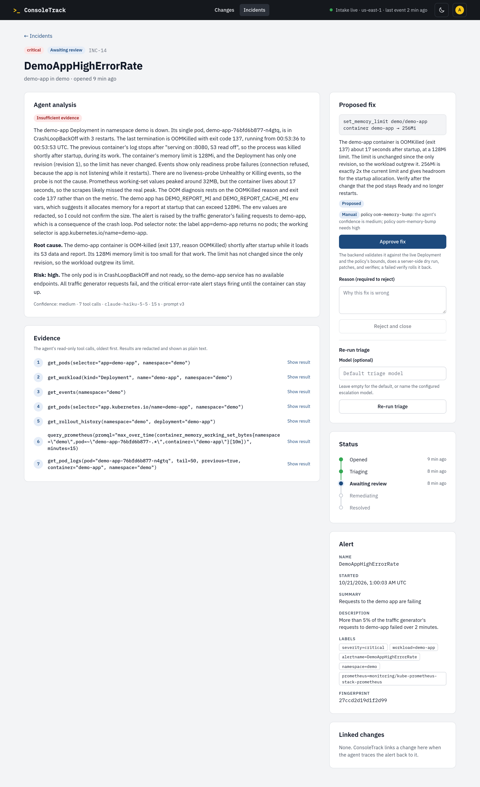
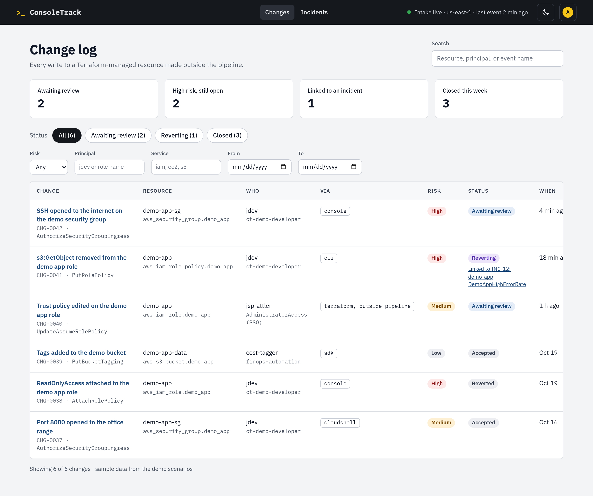
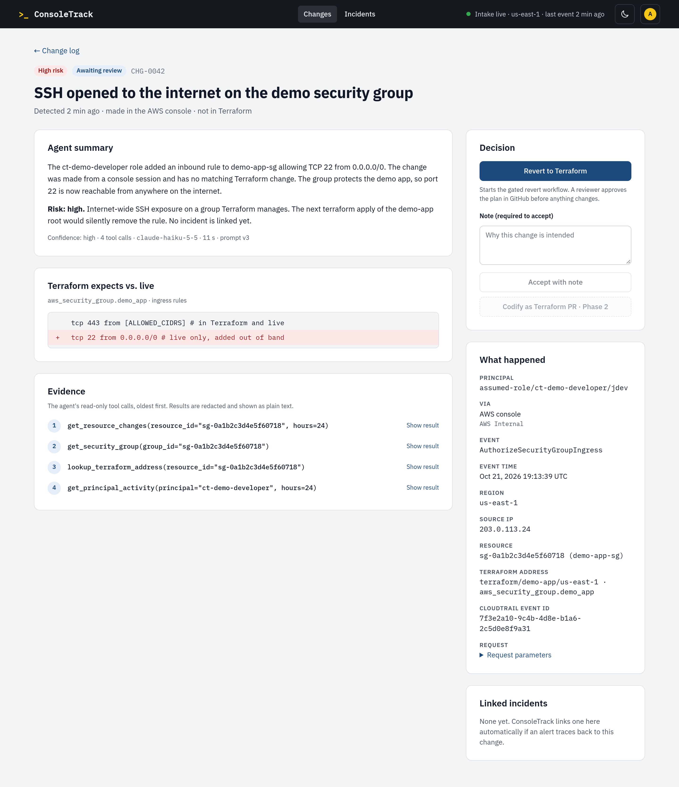
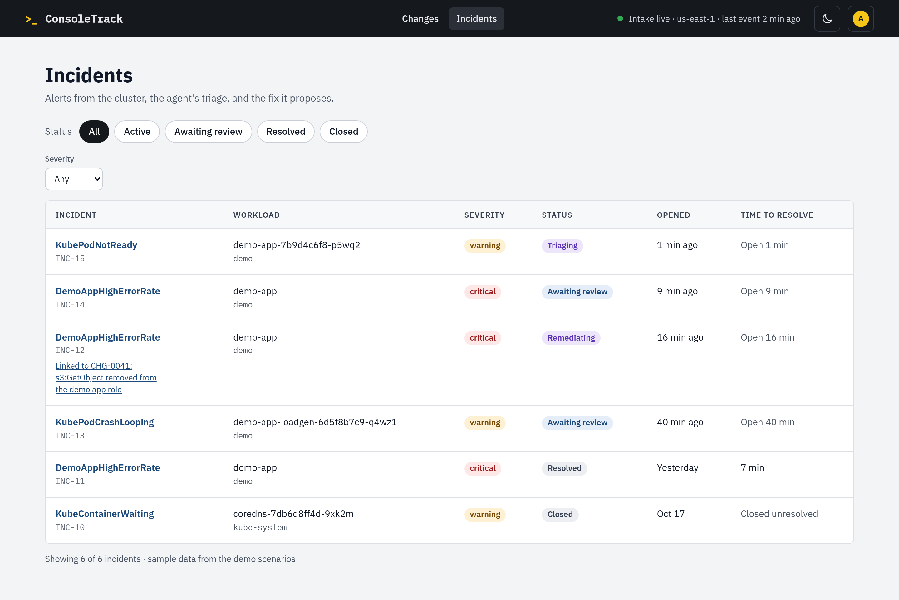
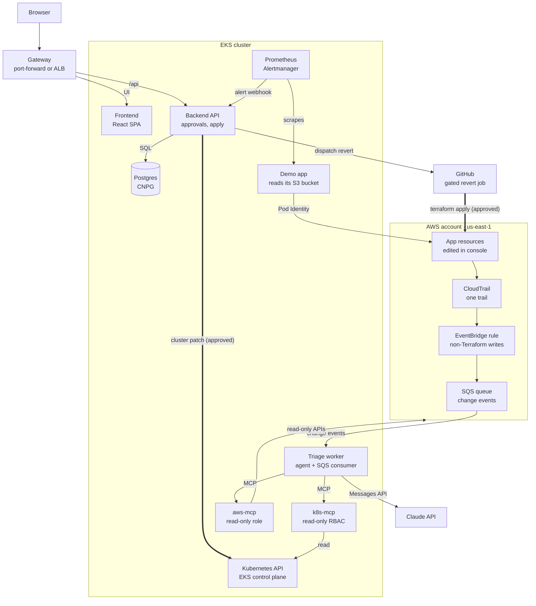

# ConsoleTrack

<!-- TODO badges: CI | License -->

Someone opens the AWS console (or the CLI, CloudShell, an SDK script, or a local `terraform apply`), changes a security group, and moves on. Nobody records why. A week later a pod gets `AccessDenied` and the on-call engineer starts from scratch.

ConsoleTrack catches every out-of-band AWS change within minutes, records who made it, how, and to which Terraform-managed resource, and links later EKS incidents back to the change that most likely caused them. A reviewer can **Accept** it with a note, **Revert** it (a gated GitHub workflow re-applies the reviewed Terraform, Phase 2), or **Codify** it (open a PR adopting it, Phase 2). Either way the change ends up documented. The triage agent only reads. AWS-side fixes always need a human's approval; one narrow cluster fix, raising a memory limit after an OOM kill, is applied automatically, verified, and rolled back if it doesn't work.

## See it in 2 minutes

- **Recorded demo, always on:** [consoletrack-demo.jennasrunbooks.com](https://consoletrack-demo.jennasrunbooks.com). The real frontend with sample data and no live AWS: click through an OOM incident the agent diagnosed and the policy gate fixed on its own, a real recorded OOM run where you approve the fix by hand, a console change waiting for review, and the postmortem editor. Nothing to log in to; a reload resets it.
- **Recorded walkthrough of the live deployment:** <!-- TODO: YouTube link once recorded --> the system running on EKS, clicked through as admin, on the Jenna's Runbooks YouTube channel.
- **Run it yourself:** `make local` on your machine with kind and Docker ([Try it without AWS](#try-it-without-aws)), or `make up` in your own AWS account ([Deploy to AWS](#deploy-to-aws)).

No logins are shared and no cluster is kept running for visitors: these four are the ways to see it.

| Incident fixed automatically | Change log |
|---|---|
|  |  |
| **Change detail** | **Incidents** |
|  |  |

<sub>Dark-theme versions are in [docs/screenshots/](docs/screenshots/).</sub>

**Reviewing this project for the course?** The [rubric table](#course-rubric-mapping) at the end maps every criterion to where its evidence is. The demo site is the quickest look; `make local` is the full system on your laptop.

<sub>The EKS screenshot of a real console change, with the agent's summary, is [docs/screenshots/eks/](docs/screenshots/eks/); the account ID and source IP are blacked out.</sub>

## Contents

- [See it in 2 minutes](#see-it-in-2-minutes)
- [How it works](#how-it-works)
- [Try it without AWS](#try-it-without-aws)
- [Deploy to AWS](#deploy-to-aws)
- [Cost](#cost)
- [Configuration](#configuration)
- [Using ConsoleTrack](#using-consoletrack)
- [Triage agent and MCP servers](#triage-agent-and-mcp-servers)
- [Agent extension pack](#agent-extension-pack)
- [Security and permissions](#security-and-permissions)
- [Development](#development)
- [Testing and CI/CD](#testing-and-cicd)
- [Repository layout](#repository-layout)
- [Roadmap](#roadmap)
- [Course rubric mapping](#course-rubric-mapping)
- [License](#license)

## How it works



The agent only reads; every fix goes through the policy gate (thick arrows).

1. **Intake.** A CloudTrail trail feeds an EventBridge rule that keeps write events from people and scripts and drops pipeline sessions (`gh-<run id>`), AWS services acting on your behalf, and ConsoleTrack's own controllers. Matches land in an SQS queue with a dead-letter queue.
2. **Change records.** The worker parses each event (who, `via` = console, CLI, CloudShell, SDK, or Terraform outside the pipeline, source IP, resource), dedupes it, and stores a change record in Postgres. (Looking up the resource's Terraform address at intake is Phase 2; the agent can look it up today.)
3. **Analysis.** The triage agent (Claude) reads the change and related CloudTrail activity through the read-only `aws-mcp` server and writes a summary, a risk rating, and options.
4. **Incidents.** Alertmanager posts alerts to the backend, which opens an incident. The agent gathers pod evidence through the read-only `k8s-mcp` server; if logs show an AWS error such as `AccessDenied`, it links the incident to the recent change that caused it.
5. **Review.** Revert, Codify (Phase 2), or Accept for changes; approve or reject the proposed fix for incidents. AWS-side fixes always need a human; the OOM memory-limit fix is the one cluster fix that runs automatically.
6. **Intake health.** A canary CronJob makes a known, harmless change every 15 minutes, so the header indicator can tell "nothing changed" from "intake is broken": Live, Delayed, Down, or Replay.

**Who does what.** There is one AI agent, the triage agent (Claude), run by the worker. The two MCP servers are its
tools, not agents: they can only read. Fixes are applied by the backend, under its own narrowly scoped identity, and
only after the policy gate allows them.

| | Started by | The agent reads through | Fix applied by |
|---|---|---|---|
| **Change** (an out-of-band AWS write) | A CloudTrail event reaching the SQS queue (EventBridge rule) | `aws-mcp`: CloudTrail lookups, the security group's live rules, IAM role and policy reads and simulation, the Terraform state | Nobody automatically. A person Accepts it (Revert and Codify are Phase 2) |
| **Incident** (a user-facing failure) | A Prometheus alert, e.g. `DemoAppHighErrorRate`: more than 5% of the traffic generator's requests failing for a minute | `k8s-mcp`: pods, restarts and termination reasons, events, logs, rollout history, metrics; plus `aws-mcp` when the logs show an AWS error such as `AccessDenied` | The backend's `remediator` identity (patch one Deployment in the `demo` namespace), automatically for the memory-limit fix within its bounds, after a person's Approve for everything else |

`aws-mcp` runs on EKS only; under `make local` the agent works without it and says so in its summary.

Full design: [product-spec.md](product-spec.md) · API: [openapi.yaml](openapi.yaml)

## Try it without AWS

Everything except the live AWS intake and Revert runs on your laptop: the UI, API, database, agent loop, cluster faults on kind, and a replay of recorded CloudTrail events.

Prerequisites: Docker, [kind](https://kind.sigs.k8s.io/), kubectl, Helm 4, [Helmfile](https://helmfile.readthedocs.io/), `make`, `curl`, `jq`, and an Anthropic API key. Give Docker at least 4 CPUs and 8 GB of memory. The [helm-diff](https://github.com/databus23/helm-diff) plugin is optional but makes reruns fast: with it, `make local` skips releases that haven't changed. Without it, every rerun upgrades kube-prometheus-stack and waits a few minutes for it to be Ready again.

```bash
git clone https://github.com/jennasrunbooks/consoletrack.git
cd consoletrack
cp .env.example .env
export ANTHROPIC_API_KEY=...   # or keep it in a password manager: op run --env-file=.env -- make local
make local                     # a kind cluster with Prometheus and the demo app, then Docker Compose
# open http://localhost:8080 (DASHBOARD_PORT) and log in as admin with the password make local prints
make local-replay-fixtures     # load recorded AWS console/CLI changes into the change log (see below)
```

**The change log starts empty.** There is no AWS account locally, so nothing reaches the change queue until you load
the recorded CloudTrail events: `make local-replay-fixtures` sends them to the local SQS-compatible queue (ElasticMQ),
and within about a minute the change log shows them: a console security-group change, a CLI `PutRolePolicy`, a
`terraform apply` from a laptop, and more, each with who, how, and risk. The agent analyzes each one (it uses your
API key; a few cents). Run it again any time: duplicates are ignored. Read-only and pipeline events in the fixtures are
filtered out on purpose, and the canary event updates intake health instead of adding a change.

The intake indicator shows **Replay**, and Revert and Codify are disabled with "AWS required". In replay mode the
agent's AWS lookups aren't available (`aws-mcp` runs on EKS), so its summaries say AWS evidence was unavailable.
`make local-down` removes everything, including the kind cluster and the database volume. `make demo-replay`, which
will do all of this in one command, is Phase 2 (#15).

**Run a fault scenario.** This is the on-call loop end to end on kind. A fault breaks the demo app, and the traffic generator's requests start failing. `DemoAppHighErrorRate` fires and Alertmanager posts it to the backend, which opens an incident. The triage worker then investigates through `k8s-mcp` and the Claude API, and proposes a fix for a human to approve.

```bash
make local-fault FAULT=oom     # or badImage, badProbe; one at a time
make local-incidents           # after ~4 minutes: the incident, the agent's root cause, its proposal, and (oom) the auto fix's steps
make local-fault FAULT=off     # the alert resolves, and the incident with it, ~3 minutes later
make local-incidents           # status: resolved
```

**See the incident as one trace.** Open Grafana at http://localhost:3000 (`GRAFANA_PORT`) and log in as admin with the password `make local` prints. The **Incident journey** dashboard lists each incident's trace, from `alert.receive` through triage, the `mcp.call`s, the gate, and the auto fix to `incident.resolve`, next to the logs and metrics. [docs/observability.md](docs/observability.md) walks through it.

| `FAULT` | What breaks | The agent should propose |
| --- | --- | --- |
| `oom` | The traffic generator asks for large reports; the app's report cache outgrows its unchanged 128Mi limit: OOMKilled under traffic, CrashLoopBackOff | `set_memory_limit` to 256Mi |
| `badImage` | An image tag that doesn't exist: ImagePullBackOff | `rollback` to the previous revision |
| `badProbe` | Probes on a path the app doesn't serve: never Ready | `rollback` to the previous revision |

Only the `oom` fix runs without a human: the `oom-memory-bump` policy is `auto`, so the backend validates the proposal, patches demo-app's limit to 256Mi through its own `remediator` ServiceAccount, verifies the fix, and rolls it back if it doesn't hold ([docs/remediation-graduation.md](docs/remediation-graduation.md)). `AUTOFIX_ENABLED=false` in `.env` makes it wait for a human too. Every other proposal waits for an admin; `rollback` can't be applied by the backend yet (approving answers `501`), so undo the revision by hand or reject it. The dashboard's Incidents page, where you'd approve one, is still to come; until then `make local-incidents` shows incidents from the API, with each remediation step. Each triage is one agent run on `TRIAGE_MODEL`, Haiku by default. On kind it took 8 tool calls and about 35k input tokens, a few cents.

`make measure` is `make local-measure` against EKS (`KUBE_CONTEXT`). It syncs demo-app at the image tag the cluster already runs, and leaves the worker alone: at 512Mi nothing OOMs, so no alert fires.

`make local-oom-run` is one OOM run end to end, for checking the fix holds (#79). It turns the fault off and waits for two clean minutes with no alert. If demo-app's rollout history has a revision that isn't ConsoleTrack's, it recreates the Deployment. Then it resets the database, turns the fault on, and follows the incident until its fix finishes, telling you if the gate needs your approval. It prints PASS or FAIL and turns the fault off again.

`make local-measure` measures demo-app's memory under the OOM fault with the limit raised to 512Mi, so it never OOMs: the working set, RSS, and report cache once a minute, then their 5-minute peaks. It stops the worker while it runs and puts everything back afterwards, even when interrupted: demo-app is recreated with a single revision, so its rollout history doesn't show the measurement's 512Mi as a lowered limit to the next triage (#79).

`make local-fault` runs Helmfile's `demoFault` state value on the `demo-app` release. A faulted pod may never become Ready, so `demoFault` also turns off Helmfile's wait and atomic rollback for that sync, which would otherwise undo the fault after the timeout. Don't use `--set faults.oom=true` for this. Run Helmfile outside `make` only with `HELM_DRIVER=configmap`.

**Timings on a laptop (Apple silicon, first run).** The kind cluster was ready in about 20s. Compose was healthy about 12s after the images were built. kube-prometheus-stack takes a few minutes on the first pull, and reruns reuse the cluster. After `FAULT=oom`, the incident opened about 4 minutes later: a 2-minute rate window, 1 minute `for`, and Alertmanager's 30s group wait. Triage finished about 20s after that.

**If no incident appears.** Check each step of the path in order. Port-forward Prometheus and Alertmanager first:

```bash
kubectl --context kind-consoletrack -n monitoring port-forward svc/kube-prometheus-stack-prometheus 9090 &
kubectl --context kind-consoletrack -n monitoring port-forward svc/kube-prometheus-stack-alertmanager 9093 &
```

1. http://localhost:9090/alerts: `DemoAppHighErrorRate` in the `demo-app` group should be pending, then firing. If it stays inactive, query `sum by (result) (rate(demo_client_requests_total[2m]))`. Only `ok` means the fault isn't serving errors: is only the faulted pod running (`kubectl --context kind-consoletrack -n demo get pods`)?
2. http://localhost:9093: the alert should be routed to `consoletrack/consoletrack/consoletrack-backend`.
3. `docker compose logs backend | grep alerts/webhook` should show `202 Accepted`. A `401` means the webhook token is out of sync; rerun `make local`.
4. `docker compose logs worker` shows the triage run.

**What runs today.** `make local` runs [scripts/local-kind.sh](scripts/local-kind.sh) around the Compose stack:

1. **kind.** It creates the kind cluster `consoletrack`, or reuses it. It builds the demo-app image and loads it into kind. Then it installs `kube-prometheus-stack` and `demo-app` from the Helmfile `local` environment (`helmfile -e local -l name=kube-prometheus-stack -l name=demo-app apply`, or `sync` without helm-diff). The demo app's traffic generator and alert rule come with it.
2. **Compose.** [docker-compose.yaml](docker-compose.yaml) with [compose/kind.yaml](compose/kind.yaml) starts these services:
   - Postgres 16.
   - ElasticMQ, the SQS-compatible queue, with queues named like the real ones.
   - The backend, which runs `alembic upgrade head` on start.
   - The dashboard, which also routes `/api` to the backend.
   - `k8s-mcp`, and the triage worker, which calls it and the Claude API.
   - The observability stack ([docs/observability.md](docs/observability.md)): an OpenTelemetry Collector, Tempo, Loki, and Grafana at http://localhost:3000 with the **Incident journey** dashboard. Metrics go to kind's Prometheus.

   It builds the images for your machine (amd64 or arm64), waits for every healthcheck, and binds every port to `127.0.0.1` only.
3. **Links.** Alertmanager in kind sends the demo app's alerts to the Compose backend, which joins kind's Docker network as `consoletrack-backend`. The script copies the backend's webhook token into kind and checks the connection from the Alertmanager pod. `k8s-mcp` uses a kubeconfig with its ServiceAccount's token, so the chart's read-only RBAC limits it here as it does on EKS. It queries Prometheus on a NodePort that's reachable only on kind's network.

CloudNativePG, the Gateway API CRDs, and the `consoletrack` release aren't installed in kind, because Compose runs Postgres, the backend, and the dashboard. Every `kubectl`, `helm`, and `helmfile` call names the `kind-consoletrack` context, so your current context is never used. `LOCAL_KIND=false make local` starts the Compose stack alone.

Still to come: `make demo-replay` ([#15](https://github.com/jennasrunbooks/consoletrack/issues/15)) and `aws-mcp` ([#9](https://github.com/jennasrunbooks/consoletrack/issues/9)). The worker's change intake runs against the real queue on EKS; locally the indicator shows Replay.

**Logging in.** There are two fixed accounts, `admin` (can act) and `viewer` (read-only). Locally you can skip the setup below: if `.env` sets no `ADMIN_PASSWORD_HASH`, Compose generates an admin password on first start and `make local` prints it, and it generates the `SESSION_SECRET` the same way. Both live in a Docker volume until `make local-down`. Otherwise, run `make hash-password` once per account and paste each output into `.env` as `ADMIN_PASSWORD_HASH` and `VIEWER_PASSWORD_HASH`; it prints an argon2id hash with every `$` doubled, which `.env` needs because make reads it. Start the stack with `make local` rather than a bare `docker compose up`, so the hash reaches Compose already un-doubled. An account with no hash can't log in. The backend also needs a `SESSION_SECRET` of at least 32 bytes and refuses to start without one. Five failed logins for one username, or from one address, within five minutes lock further attempts for five minutes (`429`).

The session cookie is always `Secure`, with no setting to turn that off. Chrome and Firefox treat `http://localhost` as a secure context and keep the cookie over plain HTTP. Safari may not: if login seems to succeed but the next page says you're logged out, use Chrome or Firefox.

## Deploy to AWS

### Prerequisites

- An AWS account you can use as a sandbox, with admin access and an AWS CLI profile
- Terraform ≥ 1.11, AWS CLI v2, kubectl, Helm 4 with the helm-diff plugin, Helmfile, jq, `make`. Or open [.devcontainer/](.devcontainer/), which has them pinned.
- An Anthropic API key with a monthly spend limit
- Optional: a domain you control (`DOMAIN`, `DNS_PARENT`). Required only for `EXPOSURE=alb`, because the load balancer serves HTTPS only.

### Steps

**Cost: about $0.23/hr with on-demand nodes, $0.26 with the ALB; `make down` when idle.** (Spot nodes, the default, bring it to about $0.20; see [Cost](#cost).)

```bash
cp .env.example .env           # fill in the values, see Configuration
make preflight                 # tools, AWS identity, helm-diff, API key, NAME_SUFFIX, ALB inputs
make bootstrap                 # once: state bucket; prints a NAME_SUFFIX to add to .env
make images                    # once, before the first make up: arm64 images to GHCR (see Images)
make up                        # Terraform (global check, us-east-1, demo-app), then Helmfile (add-ons, app)
make open                      # port-forwards the dashboard to http://127.0.0.1:8080
make down                      # when you're done: removes everything but global and the state bucket
make verify-clean              # fails if any project-tagged billable resource is left
```

`make up` takes about 20–25 minutes and is safe to rerun. In order, it:

1. runs `make preflight`;
2. checks that `consoletrack/global` has no changes to apply, and otherwise stops and asks you to apply them (`make tf-apply ROOT=consoletrack/global`; the first time, that creates it);
3. applies `consoletrack/us-east-1` (Terraform shows the plan and asks for `yes`), then `demo-app/us-east-1` if it has Terraform yet (it logs `skipped (no Terraform yet)` otherwise; the demo app then runs without its S3 bucket, which is enough for the OOM scenario);
4. runs `aws eks update-kubeconfig` under the context alias `consoletrack-eks`: every `kubectl`, `helm`, and `helmfile` call names it, so your current context is never touched;
5. writes `helm/environments/values.generated.yaml` from `.env` and the Terraform outputs (`make helm-values`, no secrets), installs the add-ons (`make addons`), creates the Secrets (`make create-secrets`), and deploys the app (`make deploy`);
6. with `EXPOSURE=alb`, ends with `make wait-for-url`, which proves `https://DOMAIN` works (see [DNS after `make up`](#dns-after-make-up)).

Terraform is AWS-only; Helmfile owns every chart: it installs everything inside the cluster from [helm/helmfile.yaml.gotmpl](helm/), the add-ons with `make addons` (`helmfile -l tier=addons apply`) and the app with `make deploy` (`helmfile -l tier=app apply` at `IMAGE_TAG`, the current commit's short SHA by default).

**Logging in.** On the first run `make create-secrets` prints the generated `admin` password once and stores only its hash in the `consoletrack-auth` Secret. Set `ADMIN_PASSWORD_HASH` (and `VIEWER_PASSWORD_HASH`) in `.env` before the first run to choose your own; the viewer can't log in without one. A rerun never rotates a Secret that exists. To start over, delete the Secret and run `make create-secrets`. `make up` ends with one block of URLs and logins for ConsoleTrack and Grafana (the chart-generated admin password, read from its Secret), and `make logins` prints it again; the admin password appears there only on the run that generated it.

**Images.** `make images` builds `backend`, `frontend`, `k8s-mcp`, and `demo-app` (and `aws-mcp` once it has a Dockerfile) for `linux/arm64` with `docker buildx` and pushes them to `ghcr.io/jennasrunbooks/consoletrack-*` tagged with the short commit SHA. It logs in with `gh auth token | docker login ghcr.io -u <you> --password-stdin`, so the GitHub CLI needs the `write:packages` scope (`gh auth refresh -s write:packages`); the token is never printed. Run it on your machine: the devcontainer has no Docker. A new package is private, and the nodes pull without an image pull secret, so once per package (after the first push) open github.com → your profile or org → Packages → `consoletrack-<name>` → Package settings → Change visibility → Public. If you also use the `deploy` workflow, add the repository under "Manage Actions access" with the Write role.

**Access without a port-forward.** `make open` is the default exposure. With `EXPOSURE=alb` (and `DOMAIN`) the dashboard is an HTTPS ALB limited to `ALLOWED_CIDRS` instead, and `make open` prints its URL. Write each entry in CIDR form (`203.0.113.7/32`, not a bare IP): EC2 rejects a bare address and the Load Balancer Controller never finishes the ALB. ExternalDNS points `DOMAIN` at the ALB about a minute after the Gateway shows `PROGRAMMED True`, and `make up` waits for that (see [DNS after `make up`](#dns-after-make-up)). If you run this repo's deploy workflow, keep a specific address out of repository variables: helmfile's diff prints `ALLOWED_CIDRS` in the Actions logs, which are public on a public repo.

**Teardown.** `make down` runs `helmfile destroy` for the app (which removes the Gateway, so the ALB goes), any Gateway left over, then (with `DOMAIN` set) gives ExternalDNS up to two minutes to delete `DOMAIN`'s records and deletes what it leaves (`make dns-clean`), then the add-ons; waits until no `project=consoletrack` load balancers or load-balancer ENIs remain; and destroys `demo-app/us-east-1` (if present), then `consoletrack/us-east-1`: its node group first, then any network interface the VPC CNI left behind (`scripts/delete-leftover-enis.sh`, also `make clean-enis`), then the rest. Terraform asks for `yes` once per step that has something to destroy (demo-app if present, the node group, the rest); a step with nothing in the state is skipped. `consoletrack/global` and the state bucket stay. `make verify-clean` then lists any leftover `project=consoletrack` load balancers, ENIs (tagged, or in a project VPC), EBS volumes, Elastic IPs, NAT gateways, and `DOMAIN`'s `A`/`AAAA`/ownership `TXT` records, and exits non-zero if there are any. `make down-all` also destroys `global` and the state bucket, after you type the bucket name. `make audit-rbac` lists what each ServiceAccount may do (`kubectl auth can-i --list`).

These targets are for a human at a terminal: they refuse to run in CI or without a TTY, and none is on the agent's allow list.

#### DNS after `make up`

With `EXPOSURE=alb`, a rebuilt cluster gets a new ALB and ExternalDNS must point `DOMAIN` at it. Two things used to leave the name dead even though the Gateway showed `PROGRAMMED True`, with no error anywhere:

1. **Stale records without ownership.** The zone (it survives `make down`) still held the previous cluster's `A`/`AAAA` alias records but no ownership `TXT` records. ExternalDNS's TXT registry won't change a record it can't prove it owns, so it logged `All records are already up to date` forever. `make down` now removes `DOMAIN`'s records itself (`scripts/dns-clean.sh`): it waits up to two minutes for ExternalDNS to do it, then deletes any `A`/`AAAA` for exactly `DOMAIN` and the `TXT` records for `DOMAIN`, `a-DOMAIN`, and `aaaa-DOMAIN` owned by this `NAME_SUFFIX`. It never touches `NS`, `SOA`, the ACM validation `CNAME`, or anything else, and prints what it deleted.
2. **Health-evaluated alias.** ExternalDNS used to write the alias with `EvaluateTargetHealth: true`. While the new ALB's targets were unhealthy, the zone answered `NOERROR` with no addresses, and resolvers cached that empty answer. It is now off (`--no-aws-evaluate-target-health` in `helm/values/external-dns.yaml.gotmpl`): there is one record and no failover target, so health evaluation could only hide the answer.

`make up` (and a human's `make deploy`) now ends with `scripts/wait-for-url.sh` (`make wait-for-url`), which polls every 15 s for up to 10 minutes until, in order: the Gateway is `Programmed` with an address; the zone's `A` record for `DOMAIN` points at that ALB; every target group of the ALB has a healthy target; the zone's own name server answers `DOMAIN` with addresses; and `curl --resolve` to the ALB returns 2xx/3xx. On success it prints the URL. Otherwise it exits non-zero naming the failed step:

| Message | Meaning | What to do |
|---|---|---|
| `stale record from a previous cluster` | An `A` record points at another ALB and has no ownership `TXT`; ExternalDNS will never change it | `make dns-clean`, then `make wait-for-url` |
| `step 3. ALB targets` with each target's state and reason | The pods behind the ALB aren't passing health checks yet | Check the pods (`kubectl -n consoletrack get pods`); rerun `make wait-for-url` |
| `step 4. Authoritative DNS … no addresses` ("NOT A FAILED DEPLOY") | Everything else works; Route 53 hasn't started answering for the new ALB yet, which took 10+ minutes on fresh clusters | Wait a few minutes, then rerun `make up` (or `make wait-for-url`); `make up` also reprints the logins |
| `step 5. HTTPS … returned 403` or no response | The ALB only accepts `ALLOWED_CIDRS` | Check that this machine's address is in `ALLOWED_CIDRS` |

**Known gap.** In this setup ExternalDNS writes no ownership `TXT` records, although `registry: txt` is set (observed on EKS: the zone holds only `A`, `AAAA`, `NS`, `SOA`, and the ACM `CNAME`). Its TXT registry then treats every existing record as someone else's, so it can create `DOMAIN`'s records but never update or delete them: anything that replaces the ALB without a `make down` leaves DNS on the old one, and `make dns-clean` is the way out. The scripts above rely on names, not ownership, for that reason. The cause isn't established; one suspect is `domainFilters` dropping the generated TXT names (`a-DOMAIN` is not under `DOMAIN`), which a `txtPrefix` such as `extdns-%{record_type}.` would put inside it.

Once the zone answers, a resolver that already cached an empty answer can keep serving it for up to 15 minutes. Flush the local cache: on macOS `sudo dscacheutil -flushcache; sudo killall -HUP mDNSResponder`, and in Chrome open `chrome://net-internals/#dns` and press Clear host cache. `make verify-clean` lists any `DOMAIN` records left after a `make down`.

### Optional: GitHub Actions on your fork

To plan and apply Terraform from pull requests and run Revert as a gated workflow, set `ENABLE_GITHUB_OIDC=true` and `GITHUB_REPO=<you>/consoletrack` before `make up`, then in your fork:

1. Create the environments `consoletrack-plan`, `consoletrack-apply`, `consoletrack-revert`, and `consoletrack-deploy`. Require your approval on `-apply` and `-revert`, and limit all but `-plan` to `main`.
2. Add an `AWS_ROLE_ARN` environment secret to each: `make gh-secrets` reads them from `terraform/consoletrack/global`'s outputs and sets them for you (run it as yourself, not an agent).
3. After every `make up`, run `make gh-deploy-config`. It sets the repository variables `deploy.yaml` and `terraform.yaml` read (from `.env`, including `USE_SPOT`) and the `consoletrack-deploy` secrets that come from Terraform outputs: the queue URLs, the canary security group, and the certificate. Those change on every `make down` → `make up`, so a deploy run with the old values fails.

Revert itself is Phase 2. When it lands, forks without OIDC will get `make revert CHANGE=<id>`, which plans and applies the demo-app root from your machine after a confirmation.

### Demo scenarios

**OOM, the automatic fix.** On kind, `make local-oom-run` runs one acceptance run end to end (about 15 minutes): a clean demo app and database, the fault on, the incident followed until the fix finishes (PASS or FAIL), then the fault off. `make local-eval-oom` repeats that run N times (default 5, about 75 minutes) and writes a results table to `eval/results/`. `make local-fault FAULT=oom|badImage|badProbe|off` toggles a fault by hand, and `make fault FAULT=oom|off` does the same on EKS (`off` recreates demo-app), and `make local-incidents` lists the incidents with the agent's root cause and proposal. The fault's report cache is sized from measurements: a steady 158–159 MiB on both kind and EKS, over the 128Mi limit and under the 256Mi fix. `make measure` (EKS) and `make local-measure` (kind) repeat that measurement at a 512Mi limit.

**Console change, the cloud loop.** Open SSH (`0.0.0.0/0`) on a security group in the console. Within about 5 minutes the change log shows who made it, `via: console`, and its risk, and the agent's analysis follows. Accept it with a note. Use `0.0.0.0/0` or a documentation address (`203.0.113.0/24`), never your own, so your IP isn't in the record.

Still stubs, for Phase 2: `make demo-drift` and `make demo-identity` (the scripted versions of the two cloud scenarios, run as the demo "developer" role) and `make demo`.

## Cost

About **$0.20 per hour** while the cluster is up, about $0.24 with the optional load balancer. Run `make down` when you're done; `global` (IAM roles, DNS zone) costs pennies a month and can stay.

| Item | $/hour |
|---|---|
| EKS control plane, standard support | 0.100 |
| 2× t4g.medium Spot nodes | 0.040 |
| One managed NAT gateway, plus its public IPv4 (and $0.045/GB processed) | 0.050 |
| EBS gp3, about 60 GB | 0.007 |
| **Total, default** | **about 0.20** |
| Optional ALB (`EXPOSURE=alb`) | +0.035 |

Claude usage is per triage run; the default model is Haiku-class. Details and sources: [product-spec.md → AWS design and cost](product-spec.md#aws-design-and-cost).

## Configuration

`.env` is the only config file; [.env.example](.env.example) documents every variable. The Makefile turns it into `TF_VAR_*` variables, the Terraform backend settings, and Helmfile's environment values. Anything set in your shell wins over `.env`, so secrets can stay out of the file. `make env-check-up` lists anything missing (names only, never values).

| Variable | Default | Description |
|---|---|---|
| `AWS_PROFILE` | | AWS CLI profile for your sandbox account |
| `AWS_REGION` | `us-east-1` | Keep it: IAM's CloudTrail events reach EventBridge only in us-east-1 |
| `NAME_SUFFIX` | generated | Suffix on every resource name: `ct-<component>-<suffix>` for global resources, `ct-<component>-<region>-<suffix>` for regional ones (`ct-eks-use1-<suffix>`), from `make bootstrap` |
| `GITHUB_REPO` | | `owner/repo` the GitHub OIDC roles trust (your fork) |
| `ENABLE_GITHUB_OIDC` | `false` | Create the GitHub OIDC provider and CI roles |
| `GITHUB_WEBHOOK_SECRET` | | Optional; only with `EXPOSURE=alb`. The backend polls Revert runs anyway |
| `K8S_VERSION` | `1.36` | EKS version, in standard support until Aug 2, 2027 |
| `USE_SPOT` | `true` | Spot nodes; set `false` if you hit capacity errors |
| `NODE_INSTANCE_TYPE` | `t4g.medium` | Graviton (arm64) nodes |
| `VPC_CIDR` | `10.0.0.0/16` | VPC range; change it only if it overlaps a network you connect to |
| `EKS_PUBLIC_ACCESS_CIDRS` | `0.0.0.0/0` | Who can reach the EKS API's public endpoint (IAM still required); keep it open while CI deploys from GitHub-hosted runners |
| `EXPOSURE` | `port-forward` | `port-forward` (nothing public) or `alb` (needs `DOMAIN`) |
| `ALLOWED_CIDRS` | | Who can reach the ALB, comma-separated, in CIDR form (`203.0.113.7/32`). Required with `EXPOSURE=alb`; `0.0.0.0/0` opens it to everyone |
| `DOMAIN` | | HTTPS hostname, e.g. `consoletrack.example.com` |
| `DNS_PARENT` | `external` | `external` (add NS records at your DNS provider) or `route53` |
| `ENABLE_BUDGET` | `true` | Create a $`BUDGET_LIMIT_USD`/month AWS Budgets alert to `BUDGET_EMAIL` |
| `ANTHROPIC_API_KEY` | | Leave empty in `.env` and set it in your shell or password manager |
| `TRIAGE_MODEL` | Haiku-class | Default triage model; `TRIAGE_MODEL_ESCALATION` for re-runs |
| `WATCHED_IAM_PATHS` | `/demo-app/` | IAM paths the intake and `aws-mcp` treat as watched |
| `ADMIN_PASSWORD_HASH`, `VIEWER_PASSWORD_HASH` | | argon2id hashes from `make hash-password`; empty means that account can't log in |
| `SESSION_SECRET` | | Signs the session cookie, at least 32 bytes; generated by Compose locally and set by `scripts/create-secrets.sh` on EKS |

## Using ConsoleTrack

| Change log | Change detail |
|---|---|
|  |  |

- **Change log:** every out-of-band change, newest first, with status chips, filters (status, principal, service, risk, date), and `via` badges.
- **Change detail:** who, what, when, and how; the Terraform address; the agent's analysis and evidence; and the Revert, Codify, and Accept actions.
- **Incidents:** alert-driven incidents with linked changes, the proposed fix, and Approve or Reject.
- **Intake indicator:** click it for the health details, the four states, and a link to the Grafana dashboard.

Light and dark themes follow your OS setting; the header toggle remembers your choice. Logins are an **admin** (can act) and a read-only **viewer**. Both are for whoever runs their own copy; no login is shared for the author's deployment, so use the [recorded demo](https://consoletrack-demo.jennasrunbooks.com) to look around. The change detail page masks the source IP to its /24 until an admin clicks Show.

## Triage agent and MCP servers

The agent calls Claude through the Anthropic SDK and can only use tools on two read-only MCP servers. It ends each run by calling `submit_analysis`, whose JSON schema is the structured result. Limits per run: 12 tool calls, 120 seconds, a token budget, and one retry.

| Server | Tools | Read-only because |
|---|---|---|
| `k8s-mcp` | `get_workload`, `get_pods`, `get_pod_logs`, `get_events`, `get_rollout_history`, `query_prometheus` | Its ServiceAccount has `get`/`list`/`watch` in allowlisted namespaces only; no Secrets or ConfigMaps |
| `aws-mcp` | `get_resource_changes`, `get_principal_activity`, `get_iam_role`, `simulate_access`, `get_security_group`, `lookup_terraform_address` | Its Pod Identity role allows reads only, and the server itself refuses anything outside the watched IAM paths and the demo-app state |

Pod logs, events, and CloudTrail fields are treated as untrusted input, and results are redacted before they're stored or sent to the model. Proposed fixes pass a deterministic validator and a policy gate: every scenario is `manual` except the OOM memory bump, which runs in `auto` behind a kill switch, a per-workload rate limit, and automatic rollback.

## Agent extension pack

How this repo was built with Claude Code, and the pieces that make that safe and repeatable. Overview: [docs/agent-extension-pack.md](docs/agent-extension-pack.md).

| Piece | Where |
|---|---|
| Project instructions | [AGENTS.md](AGENTS.md) (read by Claude Code directly; there's no `CLAUDE.md`) |
| Reusable workflows (skills) | [agent-capabilities/](agent-capabilities/) |
| Specialist subagent | [custom-agent/](custom-agent/) |
| MCP servers | [mcp-server/](mcp-server/) and `.mcp.json` |
| Hooks and guardrails | [agent-hooks/](agent-hooks/) (PreToolUse guard, PostToolUse lint) and [.claude/settings.json](.claude/settings.json) |
| Permission notes | [docs/permissions.md](docs/permissions.md) |

## Security and permissions

- **No long-lived AWS keys.** GitHub Actions assumes OIDC roles (plan, apply, revert, deploy), each trusting one GitHub environment; pods use EKS Pod Identity, one role per ServiceAccount.
- **Least privilege.** ConsoleTrack's IAM lives under `/ct/` with a permissions boundary; the revert role can change only the demo-app root. The node role has no CNI, EBS, or load balancer permissions.
- **Human approval for every AWS change.** Apply and Revert wait in the `consoletrack-apply` and `consoletrack-revert` environments.
- **Network.** Nodes are in private subnets with no public IPs. Nothing is public by default; the optional ALB is HTTPS-only and limited to `ALLOWED_CIDRS`. The EKS API endpoint is public and IAM-authenticated, so GitHub-hosted runners can deploy.
- **App.** Admin and viewer logins checked against argon2id hashes (never plaintext), with a signed 8-hour `HttpOnly`, `Secure`, `SameSite=Strict` session cookie and a limit of 5 failed logins per username and per address in 5 minutes. Every API route requires a session and every write requires admin, which a test checks against the route table. Secrets are written to Kubernetes Secrets by a script, never to Terraform state or Helm values.
- **No account IDs in the repo or logs.** CI masks the account ID, and test fixtures use `123456789012`.
- **The coding agent** has no AWS or cluster credentials, can't edit workflows, and is fenced by a guard hook. See [docs/permissions.md](docs/permissions.md).

## Development

Conventions for humans and coding agents: [AGENTS.md](AGENTS.md). The devcontainer has every tool pinned and deliberately no Docker, AWS, or cluster credentials.

```bash
make help                      # every target
make lint                      # ruff, OpenAPI validation, shellcheck, helmfile lint, no Terraform helm/kubernetes provider
make test                      # unit and contract tests, no network or API key needed
make tf-validate               # terraform init -backend=false + validate for every root
```

## Testing and CI/CD

| Layer | Tooling | Command |
|---|---|---|
| Backend unit | pytest, fake repositories, fake model | `make test-backend` |
| Contract | FastAPI schema vs `openapi.yaml` | `make test-contract` |
| Frontend | Vitest, React Testing Library, MSW | `make test-frontend` |
| Integration | pytest + Testcontainers Postgres + ElasticMQ | `make test-integration` |
| Cluster | `k8s-mcp` against kind with the real RBAC | `make test-k8s` |
| Agent eval (manual) | the OOM scenario N times with the real model, results in `eval/results/` (`make eval` for every scenario is Phase 2) | `make local-eval-oom` |
| All of the above but the cluster and eval layers | one command; integration needs Docker | `make test-all` |

| Workflow | Trigger | Does |
|---|---|---|
| `ci.yaml` | every PR and push, plus nightly | `lint`, `test`, and `terraform-fmt` are the required checks. On PRs, a `changes` job runs only the jobs for the areas the PR touches (docs-only: `lint`), and the `full-ci` label runs them all. Every job runs on push to `main` and on manual dispatch, and `local-kind` also runs nightly |
| `terraform.yaml` | PRs and merges touching `terraform/**` | per-account matrix: plan on PRs, apply on `main` after approval in `<account>-apply` |
| `deploy.yaml` | green `main` | pushes arm64 images to GHCR, then `helmfile -l tier=app apply` if the cluster is up |
| `revert.yaml` | the Revert button | re-applies `terraform/demo-app/us-east-1` after approval in `consoletrack-revert` |

## Repository layout

```text
consoletrack/
├── AGENTS.md                  # instructions for coding agents (no CLAUDE.md, by design)
├── product-spec.md            # the full spec
├── openapi.yaml               # API contract: source of truth for backend and frontend
├── Makefile                   # every command: preflight, up, deploy, demo-*, revert, down
├── .env.example               # the only config file (copy to .env)
├── docker-compose.yaml        # local stack, no AWS
├── compose/                   # Compose config: ElasticMQ queues, the dashboard's /api route
├── backend/                   # FastAPI API, intake worker, triage agent (Python, uv)
├── frontend/                  # React + Vite + TypeScript dashboard
├── demo-app/                  # the demo workload and its traffic generator (Python, uv)
├── mcp-server/
│   ├── k8s/                   # k8s-mcp: read-only Kubernetes tools
│   └── aws/                   # aws-mcp: read-only AWS tools, fixtures mode
├── terraform/                 # AWS only, one root per account and scope
│   ├── consoletrack/
│   │   ├── global/            # GitHub OIDC, CI roles, boundary, DNS zone, budget
│   │   └── us-east-1/         # VPC, NAT, EKS + managed add-ons, Pod Identity, intake
│   └── demo-app/
│       └── us-east-1/         # the demo app's AWS side: the drift target
├── helm/                      # everything inside Kubernetes
│   ├── helmfile.yaml.gotmpl   # every release, pinned versions, environments
│   ├── charts/                # consoletrack, demo-app, gateway-api-crds
│   ├── values/                # values for third-party charts
│   └── environments/          # eks, local; generated values from .env
├── scripts/                   # bootstrap, preflight, scenarios/
├── agent-hooks/               # guardrail hooks for the coding agent
├── agent-capabilities/        # reusable agent workflows (skills)
├── custom-agent/              # specialist subagents
├── docs/                      # architecture, permissions, extension pack, mockups
├── security/  ops/            # placeholders (Phase 2)
└── .github/                   # CI workflows, Dependabot, CODEOWNERS
```

## Roadmap

- **Phase 1 (Oct 26):** CloudTrail change intake with intake health and canary; change records, analysis, and Accept; Alertmanager incidents with the read-only `k8s-mcp` and `aws-mcp`; the security-group cloud scenario (and the demo role permission scenario if it's working by Oct 26) and three cluster faults; the recorded demo site; automatic fix for the OOM fault (the first remediation kind to graduate); OpenTelemetry traces, metrics, and logs in Grafana, with an alert on user impact; the dashboard; `make local` with one command; EKS via Terraform and Helmfile; CI/CD; the agent team and extension pack.
- **Phase 2 (Nov 16):** the gated Revert workflow; Codify (the agent drafts a Terraform PR adopting the change; CI must plan with no diff); the eval harness (`make eval`: each scenario N times, reporting attribution accuracy, time to triage, and cost per triage); attribute-level drift from `terraform plan -refresh-only`; harder identity scenarios (Pod Identity association, trust policy, KMS key policy); the next remediation kinds to graduate (rollback of a bad image, probe fixes).
- **Later:** Slack notifications and analytics; network-path incidents; the production hardening path.
- **Later:** a NAT gateway per AZ, or fck-nat as a raw NAT instance under `/ct/` to cut the NAT cost; Claude through Bedrock over PrivateLink, ECR pull-through cache, private API endpoint with Argo CD, Argo CD out-of-sync events as a change source, multi-region and multi-account watching (hub and spoke).

## Course rubric mapping

Built for the [DataTalksClub AI Dev Tools Zoomcamp](https://github.com/DataTalksClub/ai-dev-tools-zoomcamp) final project ([criteria](https://github.com/DataTalksClub/ai-dev-tools-zoomcamp/blob/main/project/README.md): 12 criteria, 24 points, 10 to pass).

| Criterion | Points | Where to look |
|---|---|---|
| Problem description | 2 | The opening of this README |
| Product specification | 2 | [product-spec.md](product-spec.md) and the public [issue tracker](https://github.com/jennasrunbooks/consoletrack/issues?q=is%3Aissue): acceptance criteria on every issue, agent PRs that close them |
| Agent team specification | 2 | [docs/agent-team.md](docs/agent-team.md) |
| Context management | 2 | [AGENTS.md](AGENTS.md) and its "Where to read more" index |
| Application | 2 | [Try it without AWS](#try-it-without-aws): `make local` starts the frontend, backend, and Postgres |
| Testing | 2 | `make test-all`: unit, contract, integration (Testcontainers), and frontend tests; see [Testing and CI/CD](#testing-and-cicd) |
| Containerization | 2 | [docker-compose.yaml](docker-compose.yaml), started by `make local` |
| Deployment | 2 | EKS via [terraform/](terraform/) and [helm/](helm/) ([Deploy to AWS](#deploy-to-aws)); the recorded walkthrough of the live deployment, the EKS screenshots in [docs/screenshots/eks/](docs/screenshots/eks/), and the always-on [demo site](https://consoletrack-demo.jennasrunbooks.com) |
| CI/CD | 3 | [.github/workflows/](.github/workflows/): `ci.yaml` on every PR, `deploy.yaml` on `main` |
| Observability | 2 | [docs/observability.md](docs/observability.md): one trace from alert to resolution, with metrics and logs, in Grafana with Tempo and Loki (`make local`; screenshots in [docs/screenshots/](docs/screenshots/)). On EKS, Prometheus, Alertmanager, and the intake dashboard; Tempo and Loki there are in progress |
| Alerting on user impact | 1 | `DemoAppHighErrorRate` in the `demo-app` chart's alert rules ([helm/charts/demo-app/templates/prometheusrule.yaml](helm/charts/demo-app/templates/prometheusrule.yaml)) |
| On-call agent | 2 | [docs/remediation-graduation.md](docs/remediation-graduation.md); `make local-oom-run` on kind: the alert, the diagnosis, the automatic fix, verified; the recorded incident in the demo site |

## License

[Apache-2.0](LICENSE)
