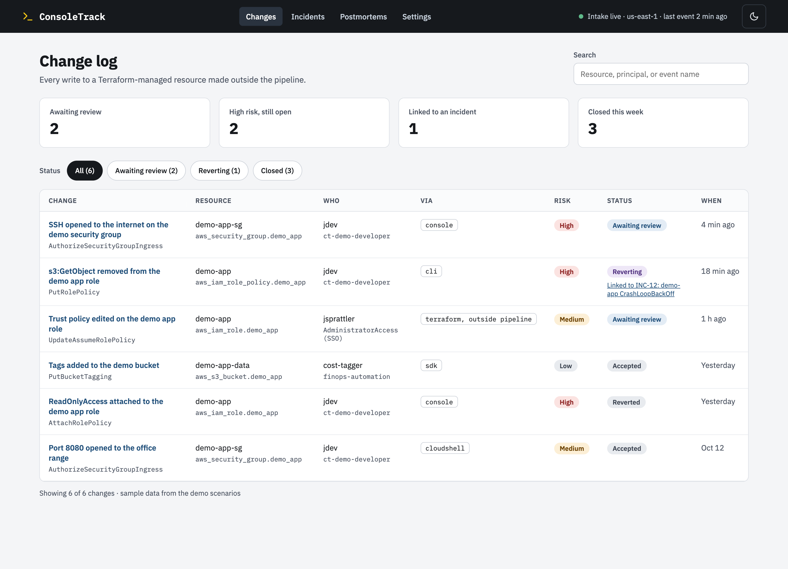
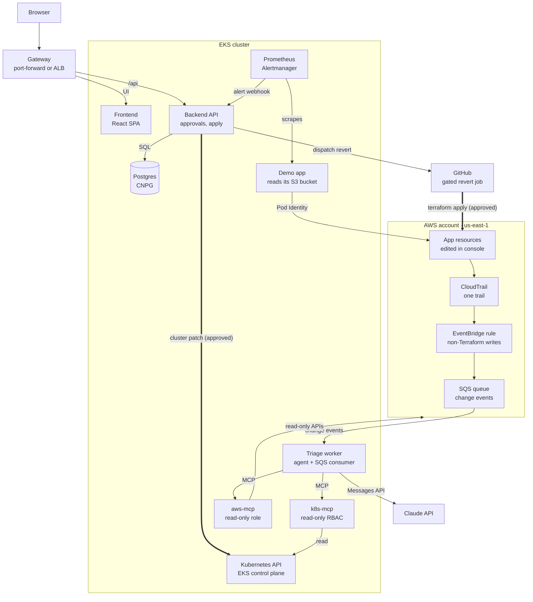
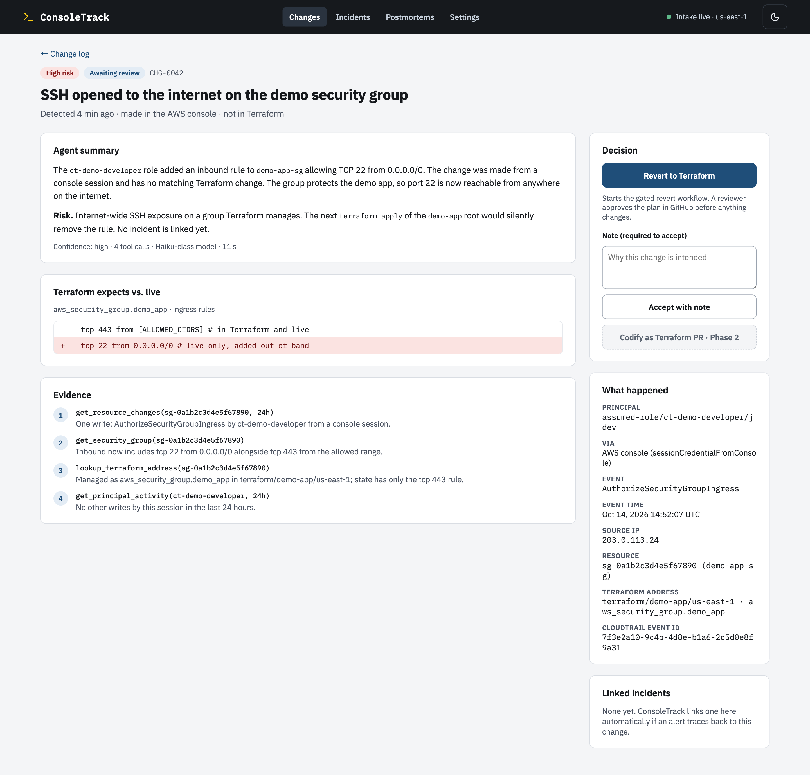

# ConsoleTrack

<!-- TODO badges: CI | License -->

Someone opens the AWS console (or the CLI, CloudShell, an SDK script, or a local `terraform apply`), changes a security group, and moves on. Nobody records why. A week later a pod gets `AccessDenied` and the on-call engineer starts from scratch.

ConsoleTrack catches every out-of-band AWS change within minutes, records who made it, how, and to which Terraform-managed resource, and links later EKS incidents back to the change that most likely caused them. A reviewer can **Revert** it (a gated GitHub workflow re-applies the reviewed Terraform), **Codify** it (open a PR adopting it, Phase 2), or **Accept** it with a note. Either way the change ends up documented. The triage agent only reads. AWS-side fixes always need a human's approval; one narrow cluster fix, raising a memory limit after an OOM kill, is applied automatically, verified, and rolled back if it doesn't work.



<sub>Design mockup; replaced with screenshots of the running app before submission.</sub>

## Contents

- [How it works](#how-it-works)
- [Try it without AWS](#try-it-without-aws)
- [Deploy to AWS](#deploy-to-aws)
- [Cost](#cost)
- [Configuration](#configuration)
- [Using ConsoleTrack](#using-consoletrack)
- [Triage agent and MCP servers](#triage-agent-and-mcp-servers)
- [Agent extension pack](#agent-extension-pack)
- [Security and permissions](#security-and-permissions)
- [Development](#development)
- [Testing and CI/CD](#testing-and-cicd)
- [Repository layout](#repository-layout)
- [Roadmap](#roadmap)
- [Course rubric mapping](#course-rubric-mapping)
- [License](#license)

## How it works



The agent only reads; every fix goes through the policy gate (thick arrows).

1. **Intake.** A CloudTrail trail feeds an EventBridge rule that keeps write events from people and scripts and drops pipeline sessions (`gh-<run id>`), AWS services acting on your behalf, and ConsoleTrack's own controllers. Matches land in an SQS queue with a dead-letter queue.
2. **Change records.** The worker parses each event (who, `via` = console, CLI, CloudShell, SDK, or Terraform outside the pipeline, source IP, resource), dedupes it, looks up the resource's Terraform address, and stores a change record in Postgres.
3. **Analysis.** The triage agent (Claude) reads the change and related CloudTrail activity through the read-only `aws-mcp` server and writes a summary, a risk rating, and options.
4. **Incidents.** Alertmanager posts alerts to the backend, which opens an incident. The agent gathers pod evidence through the read-only `k8s-mcp` server; if logs show an AWS error such as `AccessDenied`, it links the incident to the recent change that caused it.
5. **Review.** Revert, Codify (Phase 2), or Accept for changes; approve or reject the proposed fix for incidents. AWS-side fixes always need a human; the OOM memory-limit fix is the one cluster fix that runs automatically.
6. **Intake health.** A canary CronJob makes a known, harmless change every 15 minutes, so the header indicator can tell "nothing changed" from "intake is broken": Live, Delayed, Down, or Replay.

Full design: [product-spec.md](product-spec.md) · API: [openapi.yaml](openapi.yaml)

## Try it without AWS

Everything except the live AWS intake and Revert runs on your laptop: the UI, API, database, agent loop, cluster faults on kind, and a replay of recorded CloudTrail events.

Prerequisites: Docker, [kind](https://kind.sigs.k8s.io/), kubectl, Helm 4, [Helmfile](https://helmfile.readthedocs.io/), `make`, `curl`, `jq`, and an Anthropic API key. Give Docker at least 4 CPUs and 8 GB of memory. The helm-diff plugin isn't needed locally.

```bash
git clone https://github.com/jennasrunbooks/consoletrack.git
cd consoletrack
cp .env.example .env
export ANTHROPIC_API_KEY=...   # or keep it in a password manager: op run --env-file=.env -- make local
make local                     # a kind cluster with Prometheus and the demo app, then Docker Compose
# open http://localhost:8080 (DASHBOARD_PORT) and log in as admin with the password make local prints
```

The intake indicator shows **Replay**, and Revert and Codify are disabled with "AWS required". `make local-down` removes everything, including the kind cluster and the database volume. `make demo-replay`, the replayed CloudTrail change flow, is still a stub (#9).

**Run a fault scenario.** This is the on-call loop end to end on kind. A fault breaks the demo app, and the traffic generator's requests start failing. `DemoAppHighErrorRate` fires and Alertmanager posts it to the backend, which opens an incident. The triage worker then investigates through `k8s-mcp` and the Claude API, and proposes a fix for a human to approve.

```bash
make local-fault FAULT=oom     # or badImage, badProbe; one at a time
make local-incidents           # after ~4 minutes: the incident, the agent's root cause, and its proposal
make local-fault FAULT=off     # the alert resolves, and the incident with it, ~3 minutes later
make local-incidents           # status: resolved
```

| `FAULT` | What breaks | The agent should propose |
| --- | --- | --- |
| `oom` | The memory limit drops to 128Mi and the app allocates more: OOMKilled, CrashLoopBackOff | `set_memory_limit` to 256Mi (tested on kind) |
| `badImage` | An image tag that doesn't exist: ImagePullBackOff | `rollback` to the previous revision |
| `badProbe` | Probes on a path the app doesn't serve: never Ready | `rollback` to the previous revision |

Proposals wait for a human: every policy ships `manual`. The dashboard's Incidents page, where you'd approve one, is still to come; until then `make local-incidents` shows incidents from the API. Each triage is one agent run on `TRIAGE_MODEL`, Haiku by default. On kind it took 8 tool calls and about 35k input tokens, a few cents.

`make local-fault` runs Helmfile's `demoFault` state value on the `demo-app` release. A faulted pod never becomes Ready, so `demoFault` also turns off Helmfile's wait and atomic rollback for that sync, which would otherwise undo the fault after the timeout. Don't use `--set faults.oom=true` for this. Run Helmfile outside `make` only with `HELM_DRIVER=configmap`.

**Timings on a laptop (Apple silicon, first run).** The kind cluster was ready in about 20s. Compose was healthy about 12s after the images were built. kube-prometheus-stack takes a few minutes on the first pull, and reruns reuse the cluster. After `FAULT=oom`, the incident opened about 4 minutes later: a 2-minute rate window, 1 minute `for`, and Alertmanager's 30s group wait. Triage finished about 20s after that.

**If no incident appears.** Check each step of the path in order. Port-forward Prometheus and Alertmanager first:

```bash
kubectl --context kind-consoletrack -n monitoring port-forward svc/kube-prometheus-stack-prometheus 9090 &
kubectl --context kind-consoletrack -n monitoring port-forward svc/kube-prometheus-stack-alertmanager 9093 &
```

1. http://localhost:9090/alerts: `DemoAppHighErrorRate` in the `demo-app` group should be pending, then firing. If it stays inactive, query `sum by (result) (rate(demo_client_requests_total[2m]))`. Only `ok` means the fault isn't serving errors: is only the faulted pod running (`kubectl --context kind-consoletrack -n demo get pods`)?
2. http://localhost:9093: the alert should be routed to `consoletrack/consoletrack/consoletrack-backend`.
3. `docker compose logs backend | grep alerts/webhook` should show `202 Accepted`. A `401` means the webhook token is out of sync; rerun `make local`.
4. `docker compose logs worker` shows the triage run.

**What runs today.** `make local` runs [scripts/local-kind.sh](scripts/local-kind.sh) around the Compose stack:

1. **kind.** It creates the kind cluster `consoletrack`, or reuses it. It builds the demo-app image and loads it into kind. Then it installs `kube-prometheus-stack` and `demo-app` from the Helmfile `local` environment (`helmfile -e local -l name=kube-prometheus-stack -l name=demo-app sync`, so the helm-diff plugin isn't needed). The demo app's traffic generator and alert rule come with it.
2. **Compose.** [docker-compose.yaml](docker-compose.yaml) with [compose/kind.yaml](compose/kind.yaml) starts these services:
   - Postgres 16.
   - ElasticMQ, the SQS-compatible queue, with queues named like the real ones.
   - The backend, which runs `alembic upgrade head` on start.
   - The dashboard, which also routes `/api` to the backend.
   - `k8s-mcp`, and the triage worker, which calls it and the Claude API.

   It builds the images for your machine (amd64 or arm64), waits for every healthcheck, and binds every port to `127.0.0.1` only.
3. **Links.** Alertmanager in kind sends the demo app's alerts to the Compose backend, which joins kind's Docker network as `consoletrack-backend`. The script copies the backend's webhook token into kind and checks the connection from the Alertmanager pod. `k8s-mcp` uses a kubeconfig with its ServiceAccount's token, so the chart's read-only RBAC limits it here as it does on EKS. It queries Prometheus on a NodePort that's reachable only on kind's network.

CloudNativePG, the Gateway API CRDs, and the `consoletrack` release aren't installed in kind, because Compose runs Postgres, the backend, and the dashboard. Every `kubectl`, `helm`, and `helmfile` call names the `kind-consoletrack` context, so your current context is never used. `LOCAL_KIND=false make local` starts the Compose stack alone.

Still to come, tracked in [#15](https://github.com/jennasrunbooks/consoletrack/issues/15): the worker's change intake, `make demo-replay`, and `aws-mcp` (#9).

**Logging in.** There are two fixed accounts, `admin` (can act) and `viewer` (read-only). Locally you can skip the setup below: if `.env` sets no `ADMIN_PASSWORD_HASH`, Compose generates an admin password on first start and `make local` prints it, and it generates the `SESSION_SECRET` the same way. Both live in a Docker volume until `make local-down`. Otherwise, run `make hash-password` once per account and paste each output into `.env` as `ADMIN_PASSWORD_HASH` and `VIEWER_PASSWORD_HASH`; it prints an argon2id hash with every `$` doubled, which `.env` needs because make reads it. Start the stack with `make local` rather than a bare `docker compose up`, so the hash reaches Compose already un-doubled. An account with no hash can't log in. The backend also needs a `SESSION_SECRET` of at least 32 bytes and refuses to start without one. Five failed logins for one username, or from one address, within five minutes lock further attempts for five minutes (`429`).

The session cookie is always `Secure`, with no setting to turn that off. Chrome and Firefox treat `http://localhost` as a secure context and keep the cookie over plain HTTP. Safari may not: if login seems to succeed but the next page says you're logged out, use Chrome or Firefox.

## Deploy to AWS

### Prerequisites

- An AWS account you can use as a sandbox, with admin access and an AWS CLI profile
- Terraform ≥ 1.11, AWS CLI v2, kubectl, Helm 4 with the helm-diff plugin, Helmfile, jq, `make`. Or open [.devcontainer/](.devcontainer/), which has them pinned.
- An Anthropic API key with a monthly spend limit
- Optional: a domain you control (`DOMAIN`, `DNS_PARENT`). Required only for `EXPOSURE=alb`, because the load balancer serves HTTPS only.

### Steps

```bash
cp .env.example .env           # fill in the values, see Configuration
make preflight                 # tools, AWS identity, Spot quota, Kubernetes version, API key, CAA
make bootstrap                 # once: state bucket; prints a NAME_SUFFIX to add to .env
make up                        # Terraform (global, us-east-1, demo-app), then Helmfile (add-ons, app)
make open                      # port-forwards the dashboard and prints the URL and admin password
```

`make up` takes about 20–25 minutes and is safe to rerun. Terraform is AWS-only; Helmfile owns every chart: it installs everything inside the cluster from [helm/helmfile.yaml.gotmpl](helm/), the add-ons with `make addons` (`helmfile -l tier=addons apply`) and the app with `make deploy` (`helmfile -l tier=app apply`).

### Optional: GitHub Actions on your fork

To plan and apply Terraform from pull requests and run Revert as a gated workflow, set `ENABLE_GITHUB_OIDC=true` and `GITHUB_REPO=<you>/consoletrack` before `make up`, then in your fork:

1. Create the environments `consoletrack-plan`, `consoletrack-apply`, `consoletrack-revert`, and `consoletrack-deploy`. Require your approval on `-apply` and `-revert`, and limit all but `-plan` to `main`.
2. Add an `AWS_ROLE_ARN` environment secret to each, from `terraform -chdir=terraform/consoletrack/global output -json`.

Without it, Revert still works: the dashboard shows `make revert CHANGE=<id>`, which plans and applies the demo-app root from your machine after a confirmation.

### Demo scenarios

```bash
make demo-drift                # opens port 22 to the internet on the demo security group (no outage)
make demo-identity             # removes s3:GetObject from the demo app's role → AccessDenied incident
make demo                      # the three cluster faults (OOM, bad image, bad probe), one at a time
```

Each one prints the dashboard link to the change or incident it creates.

### Teardown

```bash
make down                      # Helmfile destroy, then the demo-app and regional Terraform roots
make verify-clean              # fails if any project-tagged billable resource is left
make down-all                  # optional: also the global root and the state bucket
```

## Cost

About **$0.20 per hour** while the cluster is up, about $0.24 with the optional load balancer. Run `make down` when you're done; `global` (IAM roles, DNS zone) costs pennies a month and can stay.

| Item | $/hour |
|---|---|
| EKS control plane, standard support | 0.100 |
| 2× t4g.medium Spot nodes | 0.040 |
| One managed NAT gateway, plus its public IPv4 (and $0.045/GB processed) | 0.050 |
| EBS gp3, about 60 GB | 0.007 |
| **Total, default** | **about 0.20** |
| Optional ALB (`EXPOSURE=alb`) | +0.035 |

Claude usage is per triage run; the default model is Haiku-class. Details and sources: [product-spec.md → AWS design and cost](product-spec.md#aws-design-and-cost).

## Configuration

`.env` is the only config file; [.env.example](.env.example) documents every variable. The Makefile turns it into `TF_VAR_*` variables, the Terraform backend settings, and Helmfile's environment values. Anything set in your shell wins over `.env`, so secrets can stay out of the file. `make env-check-up` lists anything missing (names only, never values).

| Variable | Default | Description |
|---|---|---|
| `AWS_PROFILE` | | AWS CLI profile for your sandbox account |
| `AWS_REGION` | `us-east-1` | Keep it: IAM's CloudTrail events reach EventBridge only in us-east-1 |
| `NAME_SUFFIX` | generated | Suffix on every resource name: `ct-<component>-<suffix>` for global resources, `ct-<component>-<region>-<suffix>` for regional ones (`ct-eks-use1-<suffix>`), from `make bootstrap` |
| `GITHUB_REPO` | | `owner/repo` the GitHub OIDC roles trust (your fork) |
| `ENABLE_GITHUB_OIDC` | `false` | Create the GitHub OIDC provider and CI roles |
| `GITHUB_WEBHOOK_SECRET` | | Optional; only with `EXPOSURE=alb`. The backend polls Revert runs anyway |
| `K8S_VERSION` | `1.36` | EKS version, in standard support until Aug 2, 2027 |
| `USE_SPOT` | `true` | Spot nodes; set `false` if you hit capacity errors |
| `NODE_INSTANCE_TYPE` | `t4g.medium` | Graviton (arm64) nodes |
| `VPC_CIDR` | `10.0.0.0/16` | VPC range; change it only if it overlaps a network you connect to |
| `EKS_PUBLIC_ACCESS_CIDRS` | `0.0.0.0/0` | Who can reach the EKS API's public endpoint (IAM still required); keep it open while CI deploys from GitHub-hosted runners |
| `EXPOSURE` | `port-forward` | `port-forward` (nothing public) or `alb` (needs `DOMAIN`) |
| `ALLOWED_CIDRS` | your IP | Who can reach the ALB |
| `DOMAIN` | | HTTPS hostname, e.g. `consoletrack.example.com` |
| `DNS_PARENT` | `external` | `external` (add NS records at your DNS provider) or `route53` |
| `ENABLE_BUDGET` | `true` | Create a $`BUDGET_LIMIT_USD`/month AWS Budgets alert to `BUDGET_EMAIL` |
| `ANTHROPIC_API_KEY` | | Leave empty in `.env` and set it in your shell or password manager |
| `TRIAGE_MODEL` | Haiku-class | Default triage model; `TRIAGE_MODEL_ESCALATION` for re-runs |
| `WATCHED_IAM_PATHS` | `/demo-app/` | IAM paths the intake and `aws-mcp` treat as watched |
| `ADMIN_PASSWORD_HASH`, `VIEWER_PASSWORD_HASH` | | argon2id hashes from `make hash-password`; empty means that account can't log in |
| `SESSION_SECRET` | | Signs the session cookie, at least 32 bytes; generated by Compose locally and set by `scripts/create-secrets.sh` on EKS |

## Using ConsoleTrack

<!-- TODO: replace mockups with screenshots of the running app -->

| Change log | Change detail |
|---|---|
|  |  |

- **Change log:** every out-of-band change, newest first, with status chips, filters (status, principal, service, risk, date), and `via` badges.
- **Change detail:** who, what, when, and how; the Terraform address; the agent's analysis and evidence; and the Revert, Codify, and Accept actions.
- **Incidents:** alert-driven incidents with linked changes, the proposed fix, and Approve or Reject.
- **Intake indicator:** click it for the health details, the four states, and a link to the Grafana dashboard.

Light and dark themes follow your OS setting; the header toggle remembers your choice. Logins are an **admin** (can act) and a read-only **viewer**.

## Triage agent and MCP servers

The agent calls Claude through the Anthropic SDK and can only use tools on two read-only MCP servers. It ends each run by calling `submit_analysis`, whose JSON schema is the structured result. Limits per run: 12 tool calls, 120 seconds, a token budget, and one retry.

| Server | Tools | Read-only because |
|---|---|---|
| `k8s-mcp` | `get_workload`, `get_pods`, `get_pod_logs`, `get_events`, `get_rollout_history`, `query_prometheus` | Its ServiceAccount has `get`/`list`/`watch` in allowlisted namespaces only; no Secrets or ConfigMaps |
| `aws-mcp` | `get_resource_changes`, `get_principal_activity`, `get_iam_role`, `simulate_access`, `get_security_group`, `lookup_terraform_address` | Its Pod Identity role allows reads only, and the server itself refuses anything outside the watched IAM paths and the demo-app state |

Pod logs, events, and CloudTrail fields are treated as untrusted input, and results are redacted before they're stored or sent to the model. Proposed fixes pass an allowlist validator and a policy gate that ships in `manual` mode for every scenario.

## Agent extension pack

How this repo was built with Claude Code, and the pieces that make that safe and repeatable. Overview: [docs/agent-extension-pack.md](docs/agent-extension-pack.md).

| Piece | Where |
|---|---|
| Project instructions | [AGENTS.md](AGENTS.md) (read by Claude Code directly; there's no `CLAUDE.md`) |
| Reusable workflows (skills) | [agent-capabilities/](agent-capabilities/) |
| Specialist subagent | [custom-agent/](custom-agent/) |
| MCP servers | [mcp-server/](mcp-server/) and `.mcp.json` |
| Hooks and guardrails | [agent-hooks/](agent-hooks/) (PreToolUse guard, PostToolUse lint) and [.claude/settings.json](.claude/settings.json) |
| Permission notes | [docs/permissions.md](docs/permissions.md) |

## Security and permissions

- **No long-lived AWS keys.** GitHub Actions assumes OIDC roles (plan, apply, revert, deploy), each trusting one GitHub environment; pods use EKS Pod Identity, one role per ServiceAccount.
- **Least privilege.** ConsoleTrack's IAM lives under `/ct/` with a permissions boundary; the revert role can change only the demo-app root. The node role has no CNI, EBS, or load balancer permissions.
- **Human approval for every AWS change.** Apply and Revert wait in the `consoletrack-apply` and `consoletrack-revert` environments.
- **Network.** Nodes are in private subnets with no public IPs. Nothing is public by default; the optional ALB is HTTPS-only and limited to `ALLOWED_CIDRS`. The EKS API endpoint is public and IAM-authenticated, so GitHub-hosted runners can deploy.
- **App.** Admin and viewer logins checked against argon2id hashes (never plaintext), with a signed 8-hour `HttpOnly`, `Secure`, `SameSite=Strict` session cookie and a limit of 5 failed logins per username and per address in 5 minutes. Every API route requires a session and every write requires admin, which a test checks against the route table. Secrets are written to Kubernetes Secrets by a script, never to Terraform state or Helm values.
- **No account IDs in the repo or logs.** CI masks the account ID, and test fixtures use `123456789012`.
- **The coding agent** has no AWS or cluster credentials, can't edit workflows, and is fenced by a guard hook. See [docs/permissions.md](docs/permissions.md).

## Development

Conventions for humans and coding agents: [AGENTS.md](AGENTS.md). The devcontainer has every tool pinned and deliberately no Docker, AWS, or cluster credentials.

```bash
make help                      # every target
make lint                      # ruff, OpenAPI validation, shellcheck, helmfile lint, no Terraform helm/kubernetes provider
make test                      # unit and contract tests, no network or API key needed
make tf-validate               # terraform init -backend=false + validate for every root
```

## Testing and CI/CD

| Layer | Tooling | Command |
|---|---|---|
| Backend unit | pytest, fake repositories, fake model | `make test-backend` |
| Contract | FastAPI schema vs `openapi.yaml` | `make test-contract` |
| Frontend | Vitest, React Testing Library, MSW | `make test-frontend` |
| Integration | pytest + Testcontainers Postgres + ElasticMQ | `make test-integration` |
| Cluster | `k8s-mcp` against kind with the real RBAC | `make test-k8s` |
| Agent eval (manual) | fault scenarios with the real model | `make eval` |
| All of the above but the cluster and eval layers | one command; integration needs Docker | `make test-all` |

| Workflow | Trigger | Does |
|---|---|---|
| `ci.yaml` | every PR and push | `lint`, `test`, and `terraform-fmt` jobs (required checks) |
| `terraform.yaml` | PRs and merges touching `terraform/**` | per-account matrix: plan on PRs, apply on `main` after approval in `<account>-apply` |
| `deploy.yaml` | green `main` | pushes arm64 images to GHCR, then `helmfile -l tier=app apply` if the cluster is up |
| `revert.yaml` | the Revert button | re-applies `terraform/demo-app/us-east-1` after approval in `consoletrack-revert` |

## Repository layout

```text
consoletrack/
├── AGENTS.md                  # instructions for coding agents (no CLAUDE.md, by design)
├── product-spec.md            # the full spec
├── openapi.yaml               # API contract: source of truth for backend and frontend
├── Makefile                   # every command: preflight, up, deploy, demo-*, revert, down
├── .env.example               # the only config file (copy to .env)
├── docker-compose.yaml        # local stack, no AWS
├── compose/                   # Compose config: ElasticMQ queues, the dashboard's /api route
├── backend/                   # FastAPI API, intake worker, triage agent (Python, uv)
├── frontend/                  # React + Vite + TypeScript dashboard
├── demo-app/                  # the demo workload and its traffic generator (Python, uv)
├── mcp-server/
│   ├── k8s/                   # k8s-mcp: read-only Kubernetes tools
│   └── aws/                   # aws-mcp: read-only AWS tools, fixtures mode
├── terraform/                 # AWS only, one root per account and scope
│   ├── consoletrack/
│   │   ├── global/            # GitHub OIDC, CI roles, boundary, DNS zone, budget
│   │   └── us-east-1/         # VPC, NAT, EKS + managed add-ons, Pod Identity, intake
│   └── demo-app/
│       └── us-east-1/         # the demo app's AWS side: the drift target
├── helm/                      # everything inside Kubernetes
│   ├── helmfile.yaml.gotmpl   # every release, pinned versions, environments
│   ├── charts/                # consoletrack, demo-app, gateway-api-crds
│   ├── values/                # values for third-party charts
│   └── environments/          # eks, local; generated values from .env
├── scripts/                   # bootstrap, preflight, scenarios/
├── agent-hooks/               # guardrail hooks for the coding agent
├── agent-capabilities/        # reusable agent workflows (skills)
├── custom-agent/              # specialist subagents
├── docs/                      # architecture, permissions, extension pack, mockups
├── security/  ops/            # placeholders (Phase 2)
└── .github/                   # CI workflows, Dependabot, CODEOWNERS
```

## Roadmap

- **Phase 1 (Oct 26):** CloudTrail change intake with intake health and canary; change records, analysis, and Accept; gated Revert; Alertmanager incidents with the read-only `k8s-mcp` and `aws-mcp`; two cloud scenarios (security group opened, demo role permission removed) and three cluster faults; automatic fix for the OOM fault (the first remediation kind to graduate); OpenTelemetry traces, metrics, and logs in Grafana, with an alert on user impact; the dashboard; `make local` with one command; EKS via Terraform and Helmfile; CI/CD; the agent team and extension pack.
- **Phase 2 (Nov 16):** Codify (the agent drafts a Terraform PR adopting the change; CI must plan with no diff); attribute-level drift from `terraform plan -refresh-only`; harder identity scenarios (Pod Identity association, trust policy, KMS key policy); Slack and analytics; the next remediation kinds to graduate (rollback of a bad image, probe fixes).
- **Later:** a NAT gateway per AZ, or fck-nat as a raw NAT instance under `/ct/` to cut the NAT cost; Claude through Bedrock over PrivateLink, ECR pull-through cache, private API endpoint with Argo CD, Argo CD out-of-sync events as a change source, multi-region and multi-account watching (hub and spoke).

## Course rubric mapping

Built for the [DataTalksClub AI Dev Tools Zoomcamp](https://github.com/DataTalksClub/ai-dev-tools-zoomcamp) final project ([criteria](https://github.com/DataTalksClub/ai-dev-tools-zoomcamp/blob/main/project/README.md): 12 criteria, 24 points, 10 to pass).

| Criterion | Points | Where to look |
|---|---|---|
| Problem description | 2 | The opening of this README |
| Product specification | 2 | [product-spec.md](product-spec.md) and the public [issue tracker](https://github.com/jennasrunbooks/consoletrack/issues?q=is%3Aissue): acceptance criteria on every issue, agent PRs that close them |
| Agent team specification | 2 | [docs/agent-team.md](docs/agent-team.md) |
| Context management | 2 | [AGENTS.md](AGENTS.md) and its "Where to read more" index |
| Application | 2 | [Try it without AWS](#try-it-without-aws): `make local` starts the frontend, backend, and Postgres |
| Testing | 2 | `make test-all`: unit, contract, integration (Testcontainers), and frontend tests; see [Testing and CI/CD](#testing-and-cicd) |
| Containerization | 2 | [docker-compose.yaml](docker-compose.yaml), started by `make local` |
| Deployment | 2 | <!-- TODO: live URL, dates, demo recording --> EKS via [terraform/](terraform/) and [helm/](helm/); [Deploy to AWS](#deploy-to-aws) |
| CI/CD | 3 | [.github/workflows/](.github/workflows/): `ci.yaml` on every PR, `deploy.yaml` on `main` |
| Observability | 2 | [docs/observability.md](docs/observability.md): one trace from alert to resolution, with metrics and logs, in Grafana |
| Alerting on user impact | 1 | `DemoAppHighErrorRate` in the `consoletrack` chart's alert rules |
| On-call agent | 2 | [docs/remediation-graduation.md](docs/remediation-graduation.md); `make demo-oom`: the alert, the diagnosis, the automatic fix |

## License

[Apache-2.0](LICENSE)
