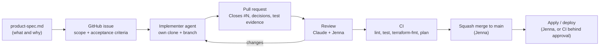

# Agent team

ConsoleTrack is built by one human and a small team of AI agents, each with a fixed role, its own
workspace, and only the access that role needs. This page is who does what, how work moves from an
idea to `main`, and where the evidence is.

The agents that **build** ConsoleTrack are separate from the agent that **runs inside** it (the
on-call triage agent). The second one is described in [architecture.md](architecture.md) and
[product-spec.md](../product-spec.md); this page is about the first.

## Roles

| Role | Who | Owns | Can't |
|---|---|---|---|
| **Product owner and reviewer** | Jenna (human) | The spec, priorities, merging, every AWS and cluster change, secrets, and the human-only files (`.github/workflows/`, `.devcontainer/`, `.env`, `product-spec.md`) | — |
| **Planner and second reviewer** | Claude (a claude.ai project session) | Drafting the spec, breaking it into issues with acceptance criteria, reviewing PRs and agent reports, researching versions and AWS behavior | Push code, approve PRs, touch AWS |
| **Implementers** | Claude Code in a devcontainer, as the machine user `jksprattler-agent`, one session per issue | The code, tests, and docs for one issue on one branch, ending in a PR | Merge, edit workflows, read `.env`, reach AWS or a cluster, approve its own PR |
| **Gatekeepers** | GitHub (the `main` ruleset, required CI checks, environments with required reviewers) and the agent guardrails (`agent-hooks/`, `.claude/settings.json`) | Enforcing the rules above, whatever any agent decides | — |

Implementers are assigned by **workstream**, and usually several run in parallel:

| Workstream | Typical issues | Clone |
|---|---|---|
| Platform (Terraform) | `global`, `us-east-1`, `demo-app` roots | `consoletrack-platform` |
| Backend | database, routes, auth, intake worker, triage agent loop | `consoletrack-be`, `consoletrack-auth`, `consoletrack-intake` |
| Cluster releases | Helmfile, charts, guardrails for Helm | `consoletrack-helm` |
| Frontend | dashboard shell, change detail, incidents | `consoletrack-fe` |

## How work flows

1. **Spec first.** Every feature starts as a section of [product-spec.md](../product-spec.md). The
   spec changes before the code does.
2. **Issue.** The planner turns a spec section into a GitHub issue with a fixed shape: *Why*, the
   spec sections to read, *Scope*, *Out of scope*, *Acceptance criteria* as checkboxes, and a
   *PR checklist*. Jenna files it. The issue list is the public task tracker.
3. **Assignment.** Jenna clones the repo fresh for the agent (`git clone … consoletrack-<area>`),
   creates the branch (`feat/…`, `fix/…`, `chore/…`), and starts the devcontainer with `dev-agent`,
   which injects the agent's GitHub token and git identity and refuses to start without them. The
   agent's first instruction is the issue number.
4. **Implementation.** The agent reads [AGENTS.md](../AGENTS.md) and the spec sections named in the
   issue, works on its branch, and runs `make lint test` before every commit. When a decision is
   genuinely Jenna's (widening IAM, changing the contract, a trade-off the issue doesn't settle), it
   stops and asks with options instead of guessing.
5. **Pull request.** The PR says `Closes #N`, lists the decisions the agent made and why, the test
   evidence, and anything it could not verify (for example, steps that need AWS or Docker, which the
   devcontainer doesn't have).
6. **Review.** Jenna and the planner review. Comments go back to the same agent session, which
   pushes fixes to the same branch. The agent resolves merge conflicts itself, so its push is the
   last one and Jenna's approval counts under the ruleset.
7. **Merge and apply.** Jenna squash-merges. Infrastructure changes are applied by Jenna from her
   machine or by CI behind the `consoletrack-apply` environment's approval; agents never apply.
8. **Next issue.** A finished agent gets its next issue in the same clone after
   `git switch main && git pull`, in a fresh session so old context doesn't leak into new work.

## Rules that keep parallel agents from colliding

- **One clone per agent.** Never git worktrees: a worktree shares `.git` (refs, config, hooks)
  across containers, and the container mount breaks its path anyway.
- **One issue per branch, one branch per agent.** Issues are cut so two agents rarely touch the same
  files. When they do (the Makefile, `.env.example`), the later PR merges `main` and resolves it.
- **Human-only files stay human-only.** An agent that needs a workflow change writes it to
  `docs/proposed-workflows/` and says so in the PR; Jenna moves it.
- **Report blocks, don't work around them.** If a guardrail or permission stops an agent, it says
  what was blocked and why, and waits.
- **Shared decisions live in the repo.** Naming, versions, and conventions go in AGENTS.md or the
  spec in the same PR that introduces them, so the next agent reads them instead of re-deciding.

## Access, by role

| | Jenna | Planner | Implementer agents |
|---|---|---|---|
| GitHub | Admin; bypass for PRs only | None (works through Jenna) | Fine-grained token on this repo: contents and PRs; no workflows, administration, secrets, or environments |
| AWS | Admin through a role in the sandbox account | None | None |
| Kubernetes | Cluster admin through an access entry | None | None |
| Merge to `main` | Yes, after review and CI | No | No |

Guardrails for implementers are in [permissions.md](permissions.md) and
[agent-extension-pack.md](agent-extension-pack.md).

## Evidence

- **Task tracker:** [issues](https://github.com/jennasrunbooks/consoletrack/issues?q=is%3Aissue),
  each with acceptance criteria.
- **Agent work:** [pull requests](https://github.com/jennasrunbooks/consoletrack/pulls?q=is%3Apr)
  authored by `jksprattler-agent`, each closing its issue, with the review conversation on the PR.
- **Gates:** CI runs on every PR; Terraform plans are posted as PR comments; applies wait in the
  `consoletrack-apply` environment.
