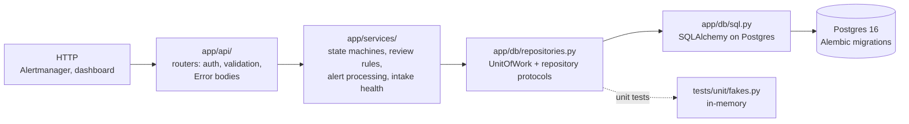
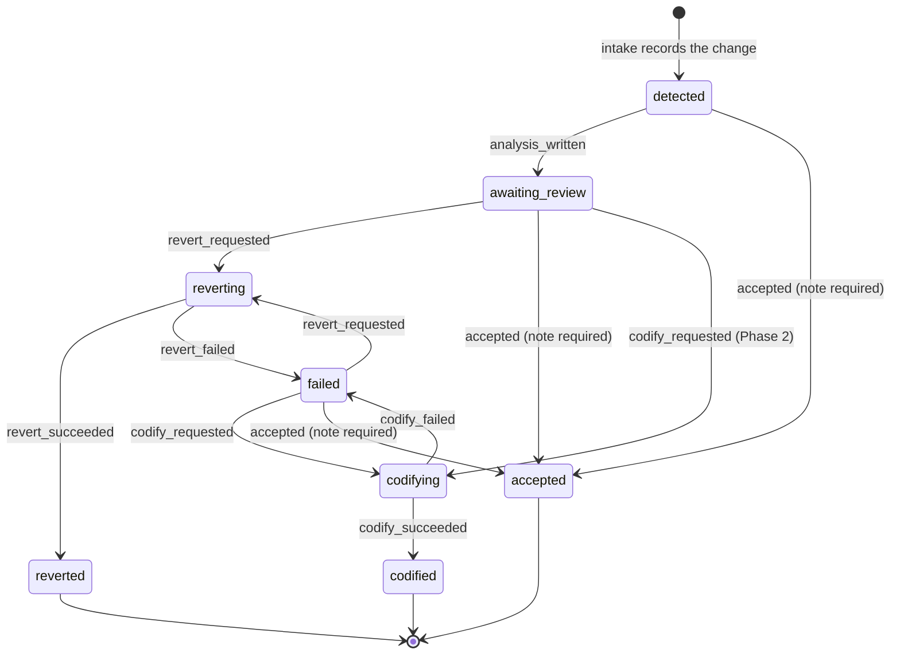
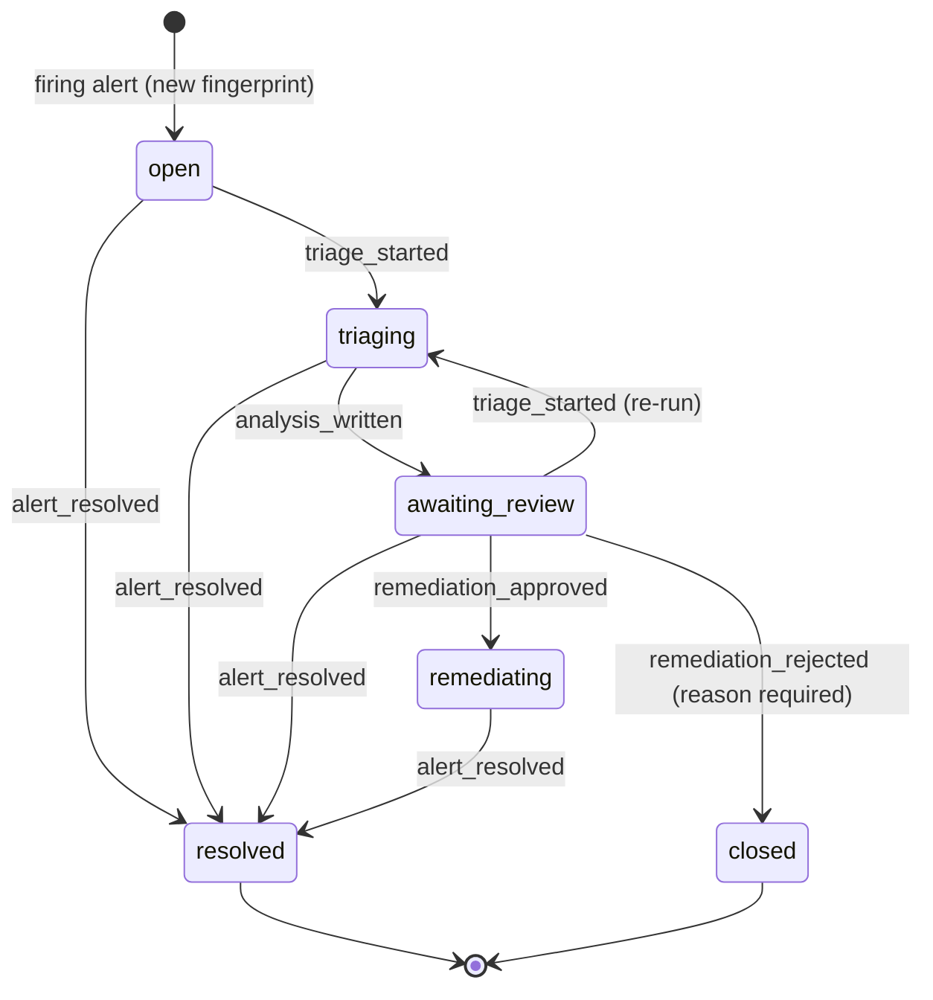

# Architecture

How the backend is put together. The system-level picture (CloudTrail → EventBridge → SQS,
the agent, the two write paths) is in [`product-spec.md`](../product-spec.md) → Architecture;
the API contract is [`openapi.yaml`](../openapi.yaml).

## Backend layers

| Layer | Rule |
| --- | --- |
| `app/api/` | HTTP only: parse and validate input (Pydantic), check auth, call one service function, return a schema from `app/schemas.py`. Never touches a session. Every error is an `Error` body (`app/api/errors.py`), including `422`s. |
| `app/services/` | Business rules. Reaches data only through a `UnitOfWork` and commits it. The only code that assigns a `status` column, through the two state machines below. |
| `app/db/` | SQLAlchemy models, the repository protocols, their SQL implementations, and Alembic migrations. `sql.py` and `session.py` are the only modules that touch a `Session`. |
| `app/schemas.py` | API models, hand-written to match `openapi.yaml`; `tests/contract/test_openapi.py` fails on any drift. |

Unit tests run the real routers and services on in-memory repositories; SQL behavior (filters,
counts, constraints, migrations) is tested only against real Postgres in `tests/integration/`.

## Change state machine

`app/services/change_state.py`. `transition(current, event)` raises `InvalidTransition` (HTTP
`409`) for anything not listed. A review decision (Revert, Accept, Codify) records `decision`,
`decided_by`, `decided_at`, and `reason`; Accept requires a non-blank note.

`openapi.yaml` allows Accept from `detected` (before the agent has run) and lets a `failed`
change be reviewed again; both are in the table above.

## Incident state machine

`app/services/incident_state.py`. The two terminal states record `decision`, `decided_by`,
`decided_at`, and `reason`: `resolved` is decided by `alertmanager`; `closed` (a rejected
remediation) needs the admin and a non-blank reason.

A firing alert reuses the unresolved incident with the same Alertmanager fingerprint; Postgres
enforces that with a partial unique index (`uq_incidents_active_fingerprint`). After the incident
is resolved or closed, the next firing opens a new incident.

## Database

Seven tables, from `product-spec.md` → Workflow and data model, created by
`backend/app/db/migrations/versions/0001_initial_schema.py`. `make db-sql` prints the whole
schema without a database.

- Enums are `VARCHAR(32)` plus a named `CHECK` constraint, not native Postgres enum types, so a
  later value is a constraint swap rather than `ALTER TYPE`. The migration freezes the values.
- `changes.cloudtrail_event_id` is unique: the intake's dedupe key.
- Indexes: `changes(status, event_time)`, `changes(principal_arn)`, `incidents(status, opened_at)`.
- `agent_runs`, `analyses`, and `remediations` point at their subject with
  `(subject_type, subject_id)` and are indexed on that pair.
- Columns beyond the spec's key columns are the ones `openapi.yaml` needs: `region`,
  `user_agent`, `request_parameters`, `title`, `drift`, and `decided_at` on changes; `labels`,
  `annotations`, and the decision fields on incidents; `agent_run_id` and `risk_reason` on
  analyses; `seq` on evidence.

## Auth (placeholder)

`require_user` (every read) and `require_admin` (every write) read the `ct_session` cookie and
look it up in a `SessionStore`. Until the login work lands, that store is an empty in-memory
placeholder, so every request without a test-injected session gets `401`: the API fails closed.
The Alertmanager webhook uses its own bearer token (`ALERT_WEBHOOK_TOKEN`), compared in constant
time; with no token configured, every webhook call is `401`.

## Intake health

`GET /api/v1/intake/health` and `/metrics` derive Live / Delayed / Down / Replay from an
`IntakeSnapshot` (queue backlog and age, dead-letter count, trail status, last canary) with the
thresholds in `product-spec.md` → Intake health and canary. The worker (#9) supplies the
snapshot; until it does, the state is Down with reasons that say nothing has reported yet.
