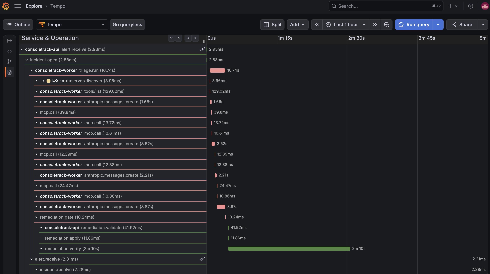
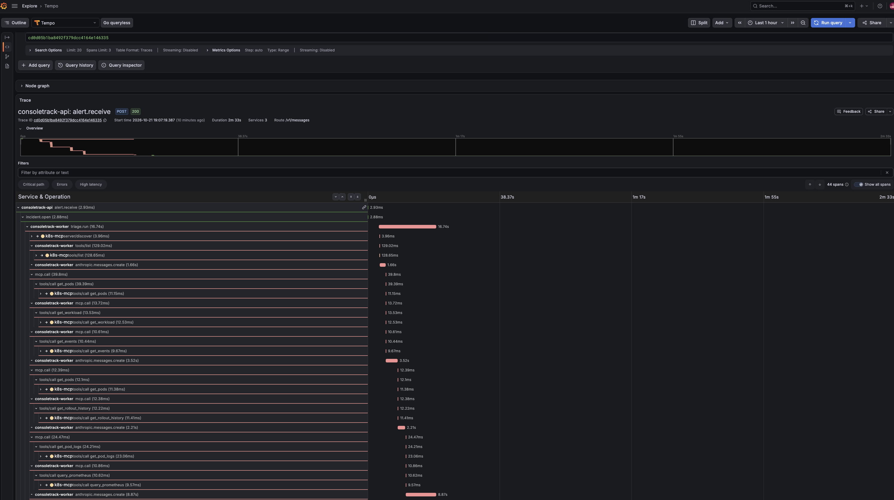
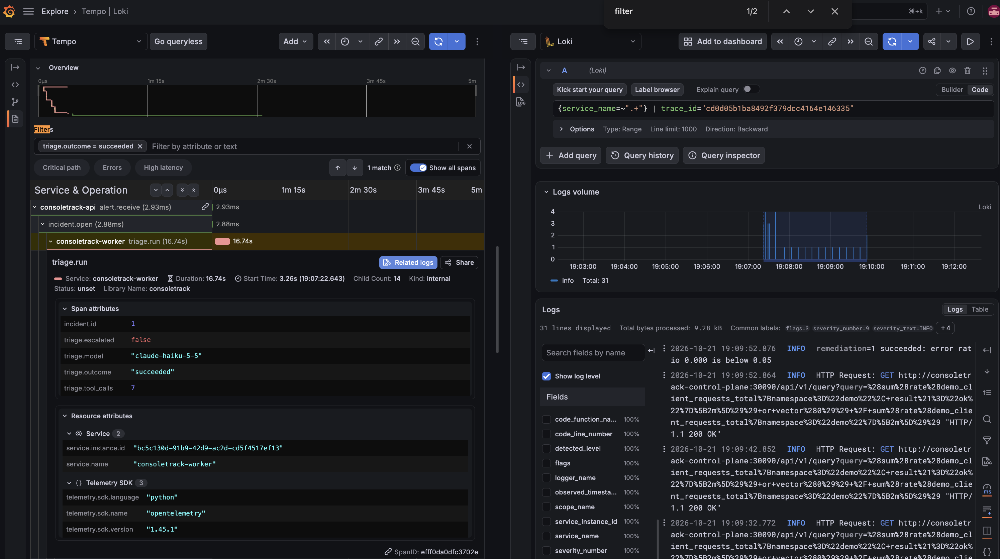
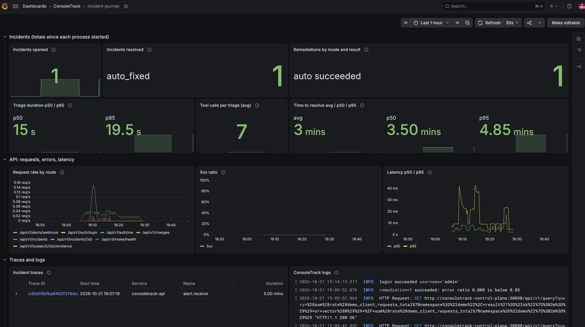

# Observability

ConsoleTrack instruments one journey end to end, the on-call loop: an alert arrives, an incident opens, the agent triages, a fix is applied or proposed, and the incident resolves. Each incident is **one trace**, and its metrics and JSON logs share the trace ID. Locally, `make local` collects all three and shows them in Grafana (#33). On EKS the same collector pipeline, Tempo, Loki, and the Incident journey dashboard run in the cluster next to kube-prometheus-stack (#99, [On EKS](#on-eks)).

Read this before you add a span, a metric, a log field, or an alert.

## The journey

```text
alert.receive ─ incident.open ─┬─ triage.run ─┬─ mcp.call × N ── tools/call <tool> (k8s-mcp)
  (API)          (API)         │   (worker)   └─ remediation.gate ─┬─ remediation.validate  (API apply loop)
                               │                                   ├─ remediation.apply
                               │                                   └─ remediation.verify
                               └─ alert.receive (resolved) ── incident.resolve   (API)
```

| Span | Where | Attributes |
|---|---|---|
| `alert.receive` | `POST /api/v1/alerts/webhook`, one per alert in the delivery (`app/services/alerts.py`) | `alert.name`, `alert.fingerprint` (SHA-256, 16 hex), `alert.status` |
| `incident.open` | the same request, for a firing alert with no open incident | `incident.id`, `incident.severity`, `incident.state` |
| `triage.run` | worker, around the run, an escalated re-run, and the gate (`app/agents/triage.py`) | `incident.id`, `triage.model` (the first run's), `triage.tool_calls`, `triage.outcome`, `triage.escalated` |
| `mcp.call` | worker, one per evidence tool call (`app/agents/tools.py`) | `mcp.server`, `mcp.tool`, `mcp.result_bytes`, `mcp.error` |
| `tools/call <tool>` | k8s-mcp, FastMCP's own server span | `mcp.method.name`, `gen_ai.tool.name`, `fastmcp.*` |
| `remediation.gate` | worker, the policy gate's decision | `incident.id`, `remediation.kind`, `remediation.mode`, `remediation.policy` |
| `remediation.validate` / `apply` / `verify` | backend apply loop (`app/services/remediation_apply.py`): read, validate, and dry run / patch / rollout, verify, and any rollback | `remediation.id`, `incident.id`, `remediation.kind`, `remediation.mode`, `remediation.result` |
| `incident.resolve` | the resolved notification's webhook request | `incident.id`, `incident.state`, `incident.resolution`, `incident.time_to_resolve_s` |

FastAPI's server spans (`POST /api/v1/alerts/webhook`, …) cover every API request except `/healthz`, `/readyz`, and `/metrics`.

**Trace context.** The journey crosses three processes and two webhook requests, so the context is stored, not just propagated:

- A firing alert that opens an incident starts a **new trace** at `alert.receive`, linked to the HTTP request's span. `incident.open`'s W3C `traceparent` is stored on the incident (`incidents.traceparent`, migration 0005).
- The worker continues that trace when it claims the incident (`TriageClaim.traceparent`), so `triage.run` is a child of `incident.open`.
- FastMCP carries the `traceparent` to the MCP server in each request's `_meta`, so k8s-mcp's span joins under `mcp.call`.
- The gate stores `remediation.gate`'s `traceparent` on the remediation (`remediations.traceparent`). The apply loop continues it when it claims the remediation, after an auto approval or a human's.
- Any later alert for an open incident, including the resolved notification, continues the incident's trace. That's how `incident.resolve` ends up in it.

A re-run (`POST /incidents/{id}/triage`) adds another `triage.run` to the same trace.

## Metrics

Exported over OTLP with their Prometheus names. The collector's remote write adds no suffixes (`translation_strategy: UnderscoreEscapingWithoutSuffixes`), and `service.name` becomes `job`. Labels stay low-cardinality: `app/telemetry.py` `METRIC_LABELS`.

| Metric | Type | Labels |
|---|---|---|
| `ct_http_requests_total` | counter | `route` (the template, e.g. `/api/v1/incidents/{id}`, or `unmatched`), `method`, `status_code` |
| `ct_http_request_duration_seconds` | histogram | same |
| `ct_incidents_opened_total` | counter | `severity` (`critical`, `warning`, `info`, `other`) |
| `ct_incidents_resolved_total` | counter | `resolution`: `auto_fixed`, `approved_fix`, `manual` (no ConsoleTrack fix) |
| `ct_triage_duration_seconds` | histogram | — |
| `ct_triage_tool_calls` | histogram | — |
| `ct_remediations_total` | counter | `kind`, `mode`, `result` (`succeeded`, `failed`, `downgraded`) |
| `ct_time_to_resolve_seconds` | histogram | — |

The intake gauges (`consoletrack_intake_*`, `consoletrack_canary_*`) are still served at `/metrics` for Prometheus to scrape (`app/metrics.py`).

## Logs

Every process logs one JSON object per line to stdout: `ts`, `level`, `logger`, `event`, plus `trace_id` and `span_id` inside a span, and any allowlisted `extra=` fields. With `TELEMETRY_EXPORTER=otlp`, the same records also go through the OTel log pipeline to Loki, where `trace_id` is structured metadata. Stack traces stay on stdout; the OTel record carries only `exception.type`. k8s-mcp logs to stderr under the stdio transport, because stdout carries the MCP protocol there.

## The user-impact alert

`DemoAppHighErrorRate` lives in the demo-app chart ([helm/charts/demo-app/templates/prometheusrule.yaml](../helm/charts/demo-app/templates/prometheusrule.yaml), #59). It fires when more than 5% of the traffic generator's requests fail over 2 minutes, for 1 minute, with severity `critical`. It's measured on the client's side: an OOMKilled pod exports nothing, so a rule on the app's own counters would never fire. It carries `consoletrack_incident: "true"`, the label the consoletrack AlertmanagerConfig routes on, so Alertmanager posts it to `POST /api/v1/alerts/webhook`, which is where the journey starts. Symptom alerts such as `KubePodCrashLooping` don't carry it: they stay in Alertmanager and Grafana, where the agent can query them, instead of opening a second incident (#79). Don't add a second copy. `ConsoleTrackApiErrors`, an alert on the API's own 5xx rate, isn't built yet; it would be a `PrometheusRule` in the consoletrack chart.

## Privacy

Telemetry never records:

- request or response bodies, or headers (cookies, `Authorization`, `ct_session`);
- passwords, password hashes, session tokens, the webhook token, the Anthropic API key;
- LLM prompts and responses, tool arguments and results, evidence text;
- CloudTrail request parameters;
- client IP addresses, AWS account IDs, and ARNs.

How that's enforced:

1. **One allowlist per service**: `ALLOWED_ATTRIBUTES` in `backend/app/telemetry.py` and `mcp-server/k8s/k8s_mcp/telemetry.py`. The exporter wrapper (`AllowlistSpanExporter`) drops every other key from spans, span events, and links. That covers what the instrumentation adds, such as `client.address`, `user_agent.original`, and `http.target`. It also drops exception messages and stack traces (the type stays) and clears status descriptions, because FastMCP puts error text there. Log records to the OTel pipeline are built from allowlisted fields only (`OtelLogHandler`).
2. **Values come from code, not input.** Span attributes hold IDs, enum values, counts, model names, and tool names. Never put a label value, an annotation, or a message from outside on a span.
3. **The login log line** keeps the username and drops the client IP. The rate limiter still uses the IP; it just isn't logged.
4. **The test**: `backend/tests/unit/test_telemetry_redaction.py` runs the whole journey on fakes. Its inputs carry a bearer token, a session cookie, a client IP, an ARN and account ID, and access keys. The test fails if any exported key is outside the allowlist, or any value matches a secret pattern (`AKIA…`/`ASIA…`, 12-digit account IDs, `arn:aws`, `ct_session`, `sk-ant-`, `Bearer`, IPv4). It runs the same check on ConsoleTrack's own spans before the exporter filters them. So code that adds a header, a prompt, or an IP to a span fails the test, even though the exporter would have dropped the key. `mcp-server/k8s/tests/unit/test_telemetry.py` does the same for k8s-mcp's spans.

**Adding an attribute:** add the key to `ALLOWED_ATTRIBUTES` and to the table above, keep the value low-risk (an ID, an enum, a count), and run `make test`. **Adding a metric label:** add it to `METRIC_LABELS` only if it has a small, fixed set of values.

`make test` stays offline. `backend/tests/conftest.py` installs in-memory exporters before any app is built, and `TELEMETRY_EXPORTER` defaults to `none`, so a process without the collector exports nothing.

## The local stack

`make local` starts these next to the app, all bound to `127.0.0.1`, with configuration under [observability/](../observability/):

| Service | Image | Config | Memory limit |
|---|---|---|---|
| `otel-collector` | `otel/opentelemetry-collector-contrib:0.163.2` | `otel-collector/config.yaml`, plus `kind.yaml` with kind | 192m (`memory_limiter` at 160 MiB) |
| `tempo` | `grafana/tempo:3.1.1` (single binary) | `tempo/tempo.yaml` | 384m |
| `loki` | `grafana/loki:3.7.9` (single binary) | `loki/loki.yaml` | 384m |
| `grafana` | `grafana/grafana:13.2.4` | `grafana/provisioning/`, `grafana/dashboards/` | 512m (#72) |

Images are pinned by tag and digest (Docker Hub, multi-arch). The configs follow each project's own single-binary example at that tag.

- **Traces and logs:** apps → collector (OTLP/HTTP, `otel-collector:4318`, not published on the host) → Tempo and Loki (Loki's native OTLP endpoint). Both keep data on tmpfs until the container restarts.
- **Metrics:** apps → collector → **kind's Prometheus**, by remote write to the same NodePort k8s-mcp queries (`consoletrack-control-plane:30090`; `enableRemoteWriteReceiver` in `helm/values/kube-prometheus-stack-local.yaml`). Without kind (`LOCAL_KIND=false`), metrics stop at the collector's `debug` exporter and the metric panels stay empty.
- **Grafana:** the Prometheus, Tempo, and Loki datasources, with Tempo → Loki trace-to-logs on `trace_id` and Loki → Tempo links back. The **Incident journey** dashboard (`observability/grafana/dashboards/incident-journey.json`) is the home dashboard. The admin password is `GRAFANA_ADMIN_PASSWORD`, or a generated one that `make local` prints, never `admin/admin`.

The dashboard's journey panels (incidents opened and resolved, remediations, triage and time-to-resolve percentiles) read cumulative values since each process started. That way they show data after a single scenario run, where `rate()` over a series with one sample would show nothing. They reset when the backend or worker restarts. The request panels use `rate()`.

`TELEMETRY_EXPORTER=none make local` runs the app without exporting anything; the stack still starts.

## On EKS

`make addons` installs four `tier=addons` releases in `monitoring` next to kube-prometheus-stack (`helm/helmfile.yaml.gotmpl`, `eks` environment only; on kind, `make local` keeps using Compose):

| Release | Chart | Image | Storage | Memory request / limit |
|---|---|---|---|---|
| `otel-collector` | `open-telemetry/opentelemetry-collector` 0.175.1, Deployment | `otel/opentelemetry-collector-contrib:0.163.2` (same digest as Compose) | none | 64Mi / 192Mi (`memory_limiter` at 160 MiB) |
| `tempo` | `grafana-community/tempo` 3.1.0, single binary | `grafana/tempo:3.1.1` | emptyDir, 24 h retention | 128Mi / 384Mi |
| `loki` | `grafana-community/loki` 18.15.1, `deploymentMode: Monolithic` (single binary) | `grafana/loki:3.7.9` | emptyDir (filesystem), 24 h retention | 128Mi / 384Mi |
| `grafana-dashboards` | `./charts/grafana-dashboards` | — | — | — |

- **Collector config is not forked.** `helm/values/otel-collector.yaml.gotmpl` reads `observability/otel-collector/config.yaml` and merges `kind.yaml` over it, exactly as Compose does with kind, then changes only the three exporter endpoints to the in-cluster Services. Traces → `tempo:4318`, logs → `loki:3100/otlp`, metrics → kube-prometheus-stack's Prometheus by remote write (`enableRemoteWriteReceiver`, in `helm/values/kube-prometheus-stack-eks.yaml`). Metrics go by remote write, as with kind, because the apps export `ct_*` only over OTLP; they have no `/metrics` endpoint for those.
- **Apps.** With the `observability` environment value (true on `eks`), the consoletrack chart sets `TELEMETRY_EXPORTER=otlp` and `OTEL_EXPORTER_OTLP_ENDPOINT=http://otel-collector.monitoring.svc.cluster.local:4318` on the backend, the worker, and k8s-mcp. Without it they export nothing.
- **Grafana.** `kube-prometheus-stack-eks.yaml` adds the Tempo and Loki datasources with the same UIDs and links as `observability/grafana/provisioning/datasources/datasources.yaml`, and opens on the Incident journey dashboard. `defaultDashboardsEnabled: false` drops the stack's ~30 default dashboards. The `grafana-dashboards` release ships the Incident journey dashboard, read from `observability/grafana/dashboards/incident-journey.json` at render time (one copy), plus the three defaults worth keeping: **Node Exporter / Nodes**, **Kubernetes / Compute Resources / Pod**, and **Alertmanager / Overview** ([its README](../helm/charts/grafana-dashboards/README.md)). Intake health stays in the consoletrack chart.
- **Nothing persists.** Tempo and Loki keep data on emptyDirs, so a pod restart empties them and `make down` has no PVC to remove. None of the three mounts a service account token or gets cluster-wide RBAC.

To open a trace on EKS, run `make fault FAULT=oom`. Then port-forward Grafana and log in with the command and password `make logins` prints (`kubectl … -n monitoring port-forward svc/kube-prometheus-stack-grafana 3000:80`), and follow the steps below from step 3. `make down` destroys these releases with the other add-ons (`scripts/down-cluster.sh`).

## Opening the trace in Grafana

1. `make local`, then `make local-fault FAULT=oom`. About 4 minutes later the incident opens; triage takes about 20 seconds, and the auto fix runs right after. Once verify passes, the alert resolves on its own.
2. Open http://localhost:3000 and log in as `admin` with the password `make local` printed (or `docker compose exec -T grafana cat /var/lib/grafana/admin-password`). The **Incident journey** dashboard opens.
3. In **Incident traces**, click the trace ID. The trace view shows `alert.receive` → `incident.open` → `triage.run` with its `mcp.call`s and k8s-mcp's `tools/call` spans → `remediation.gate` → `remediation.validate` / `apply` / `verify` and, once the alert resolves, `alert.receive` → `incident.resolve`. A span only appears once it ends, so reload the trace (**Run query**) after the incident resolves. Collapse the `mcp.call` rows (the arrows next to **Service & Operation**) to fit the whole journey on one screen.
4. Click a span, e.g. `triage.run`, and then **Related logs**: Loki opens next to the trace with every line that carries the trace ID. A log line's **Open trace** link goes back.

You can also search in **Explore → Tempo** with TraceQL, e.g. `{ name = "alert.receive" && span.alert.status = "firing" }` or `{ name = "triage.run" && span.triage.escalated = true }`. Set the time range to cover the incident: Explore searches only that window.

### Screenshots

From a `make local` run with `FAULT=oom` on kind, where the auto fix succeeded (#33).

The whole journey in one trace, with the tool calls collapsed. The apply loop's spans (`consoletrack-api`) continue the worker's trace from the remediation row, and `incident.resolve` arrives with the resolved notification about three minutes later:



The triage expanded: each `mcp.call` with FastMCP's client span and k8s-mcp's server span below it, and the Anthropic SDK's `anthropic.messages.create` spans between them:



**Related logs** on `triage.run`: Loki's lines for the trace, including the apply loop's. The span's attributes are only the allowlisted ones:



The **Incident journey** dashboard after that run:


