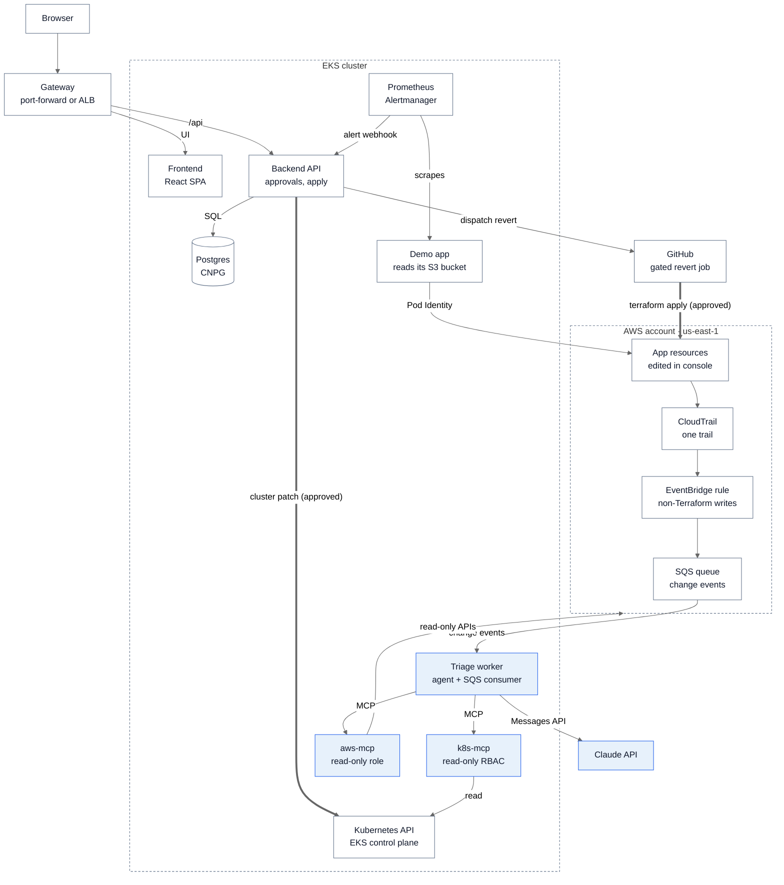

# ConsoleTrack: Product Spec

Last updated Oct 23, 2026

## Summary

ConsoleTrack turns undocumented cloud changes into documented, reviewable records. It catches console ("ClickOps") changes and Terraform drift within minutes, and when a workload on EKS breaks because of one, it traces the Kubernetes symptom back to the AWS change that caused it. The agent only reads; fixes arrive as Terraform pull requests or approved, gated workflow runs.

**Problem.** Developers with console access make quick changes to unblock themselves: a policy tweak, an opened security group port, a bumped limit. Nobody records why, Terraform state drifts, and the next `terraform apply` either silently reverts the change or fails. When an outage follows, the on-call engineer sees `AccessDenied` in pod logs and has to search CloudTrail by hand to find who changed what. In-cluster AI agents don't look at the AWS layer, and managed agents investigate incidents but don't treat drift as the thing to track.

**What the system does.**

1. **Change-driven.** Any write API call to a Terraform-managed resource by a principal other than the Terraform or CI role flows through CloudTrail → EventBridge → SQS and opens a change record within minutes, even if nothing is broken yet.
2. **Symptom-driven.** A Prometheus alert (an `AccessDenied` error rate, a CrashLoopBackOff) opens an incident. The agent gathers pod evidence and looks for recent out-of-band changes to the AWS resources that workload depends on.
3. The agent writes a plain-language summary: who made the change, what changed, when, from the console or CLI, how it differs from Terraform, the risk it introduces, and the root cause when there is a symptom.
4. A reviewer picks **Revert** (re-apply Terraform through a gated workflow), **Codify** (the agent drafts a pull request that adopts the change in Terraform, checked for least privilege), or **Accept with a note**.
5. Every decision lands in a change log, so the unspoken change ends up documented and linked to any incident it caused.

**Who it's for.** Platform and SRE teams who share AWS accounts with application developers, manage infrastructure with Terraform, and haven't fully locked down console access (which is most teams). For this project it is also a portfolio piece covering EKS, IAM and Pod Identity, CloudTrail and EventBridge, Terraform, MCP, and governed agent actions.

**Expected behavior in the demo.** Someone opens all traffic from `0.0.0.0/0` on a security group in the console; a few minutes later a change record shows who did it, how, and the high risk, with the agent's analysis and the read-only AWS lookups behind it, and a reviewer accepts it with a note. Separately, `make fault FAULT=oom` makes the demo app run out of memory under its traffic; the error-rate alert opens an incident, the agent diagnoses the OOM kill, and the backend applies, verifies, and resolves the memory-limit fix. In Phase 2, scripted versions (`make demo-drift`, `make demo-identity`) run the console change and an IAM permission removal as a separate "developer" role, and Revert restores the Terraform state.

**How this differs from existing tools.** HolmesGPT and K8sGPT reason mainly inside the cluster and its observability stack. AWS DevOps Agent is a managed, per-second-billed incident investigator. None of them makes the out-of-band cloud change the primary object, documents it, and reconciles it with Terraform through least-privilege, human-approved actions.

## Name

The project is ConsoleTrack: it keeps track of every console change, documents it, and ties it back to Terraform. It names the problem rather than one feature, so it still fits as the suite grows into network and other domains. The same name is used everywhere below.

| Asset | Name |
| --- | --- |
| Product | ConsoleTrack |
| GitHub repo | `jennasrunbooks/consoletrack` |
| Python package | `consoletrack` (PyPI name unclaimed as of Oct 13, 2026) |
| Helm chart and namespace | `consoletrack` |
| Container images | `ghcr.io/jennasrunbooks/consoletrack-backend` (also runs the worker), `-frontend`, `-k8s-mcp`, `-aws-mcp`, `-demo-app` |
| AWS resource name prefix | `ct-` on every AWS resource ConsoleTrack owns (the hub infrastructure, its roles, the canary, and the scenario tooling), followed by the component and a short random suffix: `ct-<component>-<suffix>`, for example `ct-eks-use1-a1b2`, `ct-tfstate-a1b2`, `ct-canary-sg-use1-a1b2`. The demo app is a watched workload, not ConsoleTrack, so its resources use `demo-app-` instead (`demo-app-sg-use1-a1b2`, `demo-app-data-use1-a1b2`), matching its directory and future account. Regional resources, and the IAM roles tied to them, add a short region code before the suffix (`ct-<component>-<region>-<suffix>`, `use1` for us-east-1): IAM and S3 names are unique per account or worldwide, so a second region could otherwise collide, and dashboards can group by name. Account-wide resources in `global/` (the OIDC provider, CI roles, boundary, DNS zone, state bucket) keep `ct-<component>-<suffix>`. Each root sets its prefix once in `local.name_prefix` |
| AWS tags | `project = consoletrack`, `owner = <suffix>` |
| IAM path | `/ct/` for ConsoleTrack's IAM roles and policies and `/demo-app/` for the demo app's. Policies scope ARNs by these paths (`arn:aws:iam::<account>:role/ct/*`, `role/demo-app/*`), so ConsoleTrack's own permissions and the workload it watches never overlap |

## Scope

Phase 1 targets the Monday, Oct 26 submission (6 pm local time): every criterion of the course rubric as revised on Oct 16 (see Rubric mapping), plus the core cloud loop (change intake, the security-group scenario, and aws-mcp; the identity scenario if it works by Oct 26; the gated revert in Phase 2). Phase 2 targets the Nov 16 fallback deadline and the post-course version. The Oct 22 check (see Plan) passed: the thin end-to-end slice worked on kind, so the submission is Oct 26.

| Phase | Feature | Why it's in this phase |
| --- | --- | --- |
| 1 (Oct 26) | Alertmanager webhook → incident; triage agent with read-only `k8s-mcp` | Symptom-driven trigger; core AI capability |
| 1 (Oct 26) | CloudTrail trail + EventBridge rule + SQS → change records for out-of-band writes, plus intake health endpoint, header indicator, and canary | Change-driven trigger; the main differentiator |
| 1 (Oct 26) | Read-only `aws-mcp`: CloudTrail lookup, IAM read and policy simulation, security group read, Terraform state lookup | Lets the agent connect a pod symptom to an AWS change |
| 1 (Oct 26) | Scenarios: security group opened (no outage); demo app role permission removed (outage), which needs aws-mcp and the demo-app root and moves to Nov 16 if not working on Oct 26 | One demo per trigger |
| 2 (Nov 16) | Revert through a gated GitHub workflow that re-applies the `terraform/demo-app/us-east-1` root | Fixes cloud drift without giving the app AWS write access |
| 1 (Oct 26) | Dashboard: incidents, change log, evidence, approve/reject, postmortem editor; the same UI as an always-on recorded demo on GitHub Pages (sample data, no AWS) | Frontend criterion; makes changes documented |
| 1 (Oct 26) | Cluster-side remediation (patch, rollout undo) through the policy gate: `manual` for every kind except `set_memory_limit` (see the OOM row) | Baseline faults and the auto-remediation path |
| 1 (Oct 26) | Terraform + Helm on EKS, CI/CD, local run with one command, reviewer deploy, agent team and context docs | Graded criteria |
| 1 (Oct 26) | Auto-remediation for the cluster OOM scenario: the first remediation kind to graduate to auto mode (memory-limit patch in the demo namespace, validated, verified, rolled back on failure). The scenario is the app outgrowing an unchanged 128Mi limit: the fault changes only the traffic generator, whose requests make the app's report cache grow to 140 MiB, so raising the limit to 256Mi is the right fix (measured on kind and EKS: a steady peak of 158–159 MiB, the 140 MiB cache plus about 19 MiB of app). An OOM that follows a revision which lowered the limit is fixed by a rollback instead, which stays manual. The backend labels the revisions it creates (consoletrack.io/remediation and consoletrack.io/action), so triage never reads its own fix as a human change or a rollback target | The on-call agent fixes an alert end to end; moved up from Phase 2 for the course rubric |
| 1 (Oct 26) | Observability: OpenTelemetry traces, metrics, and structured logs sharing a trace ID across the incident journey, in Grafana (Tempo, Loki, Prometheus); an alert on user impact (demo app error rate); only alerts labeled consoletrack\_incident="true" open incidents, grouped by namespace and workload | Makes the on-call loop visible as one trace; course rubric |
| 2 (Nov 16) | Codify: agent drafts an HCL pull request adopting the change; CI plan must show no diff | Turns a good console change into code |
| 2 (Nov 16) | Drift confirmation with a targeted `terraform plan -refresh-only` job | Exact attribute-level diff instead of request parameters |
| 2 (Nov 16) | Scenarios: demo app's Pod Identity association or role trust policy changed; KMS key policy edited | Harder identity failures |
| Later | Slack notifications; analytics (changes by principal, time to document, drift reverted vs codified) | Team visibility; moved behind Codify and the eval harness, which show more |
| 2 (Nov 16) | Eval harness: `make eval` runs each scenario N times and reports attribution accuracy, time to triage, and cost per triage | Turns a demo of the agent into a measured agent; moved up from Later |
| Later | Network-path incidents (security groups, ALB target health, DNS, IP exhaustion) | Next domain, built on the same change intake |
| Later | Production hardening path (a NAT gateway per AZ, fck-nat as a cheaper NAT instance under /ct/, Bedrock over PrivateLink, ECR pull-through cache, private API endpoint with Argo CD); watching more regions through EventBridge forwarding; Argo CD out-of-sync events as a change source; multi-account via an organization trail; headless Claude Code runner; commit tracing; security criterion artifacts | Beyond the course |

Phase 1 describes drift from CloudTrail request parameters plus the Terraform address of the resource. The exact attribute diff from `terraform plan` arrives in Phase 2.

**Out of scope.** Multi-cluster support, auth beyond a single shared admin login, auto-remediation of any AWS-side change (cloud fixes always need a human), drift in resources Terraform doesn't manage, and production-grade HA.

## Architecture

Two inputs feed one agent: Prometheus alerts from inside the cluster, and CloudTrail change events from the AWS account. There are exactly two write paths, both behind an approval: the backend's cluster patch, and a GitHub workflow that re-applies Terraform.



The agent only reads. Every fix goes through the policy gate (thick arrows): AWS-side fixes always wait for a human, and one cluster fix, raising a memory limit after an OOM kill, is applied automatically and verified.

The triage worker sees Kubernetes only through `k8s-mcp` and AWS only through `aws-mcp`, each with read-only permissions. AWS changes are fixed by the revert workflow in GitHub, whose role can change only the `terraform/demo-app/us-east-1` root and only after a reviewer approves the run.

| Component | Tech | Role |
| --- | --- | --- |
| Frontend | React, Vite, TypeScript, nginx | Incidents, change log, evidence, approve/reject, postmortem editor; light and dark themes from CSS variables, defaulting to the OS setting with a header toggle that is remembered per browser |
| Backend API | Python 3.12, FastAPI, SQLAlchemy, Alembic | Webhook intake, state machines, remediation validation, cluster patch, triggers revert workflow |
| Triage worker | Same image as backend, Anthropic SDK, FastMCP client, boto3 | Consumes the SQS change queue and runs agent loops for changes and incidents |
| k8s-mcp | FastMCP, kubernetes client | Read-only cluster tools |
| aws-mcp | FastMCP, boto3, own Pod Identity role | Read-only CloudTrail, IAM, EC2, and Terraform state tools |
| Change intake | CloudTrail trail, EventBridge rule, SQS | Delivers out-of-band write events within minutes |
| Demo app | Small Python service using Pod Identity to read from S3 | Gives the identity scenario a real AWS dependency |
| Postgres | CloudNativePG (EKS), Postgres 16 container (local) | Incidents, changes, evidence, analyses, remediations |
| Observability | kube-prometheus-stack | Alert rules, Alertmanager webhook to backend |
| Infrastructure | Terraform modules, Helm | `terraform/consoletrack/global` (IAM and GitHub OIDC, Route 53 zone, optional budget), `terraform/consoletrack/us-east-1` (private VPC with a NAT gateway, EKS, Pod Identity roles, intake), and `terraform/demo-app/us-east-1` (demo IAM, S3, security group); settings from `.env` |
| CI/CD | GitHub Actions with AWS OIDC | Test, build, deploy, plan on PRs, apply on merge, gated revert of the demo-app root |

## AWS design and cost

The cluster runs only when needed, with private nodes and nothing public by default: about $0.20 an hour while up (about $0.23 with the optional ALB). At that rate, about 60 hours of building and testing cost roughly $12, while leaving it on for a whole month (730 hours) would cost about $145. Nothing stays up for reviewers: they see the recorded demo site and the walkthrough, or run \`make local\` or \`make up\` themselves. With on-demand nodes and the ALB, a recording session costs about $0.26 an hour, plus NAT data at $0.045/GB. The EKS control plane is the biggest line, so the main lever is still `terraform destroy` when idle.

**Terraform layout.** Code is organized by AWS account first, then by scope (global or a region), one root per folder, with one file per concern (`eks.tf`, `vpc.tf`, `iam.tf`, and so on) inside each root. Each top-level directory under terraform/ is named for the AWS account it targets. For the course, everything runs in one account, the ConsoleTrack hub, with one shared demo setup.

- `terraform/consoletrack/` holds everything in the ConsoleTrack hub account:
  - `global/` (account-wide and long-lived, pennies a month): GitHub OIDC provider and the plan, apply, deploy, and revert roles (only when `enable_github_oidc = true`; reviewers leave it off), the permissions boundary, the demo "developer" role, the Route 53 zone when `DOMAIN` is set, and an optional AWS Budgets alert at $25. The alert is controlled by `enable_budget`: on by default for reviewers with standalone accounts, and off for the author, whose billing, budgets, and Cost Explorer live only in the AWS Organizations management account. Files: `iam.tf`, `route53.tf`, `budgets.tf`.
  - `us-east-1/` (regional platform, created and destroyed freely, about 15 to 20 minutes each way): `vpc.tf` (private subnets, one managed NAT gateway, S3 gateway endpoint), `eks.tf` (cluster, Spot node group, add-ons, access entries), `pod-identity.tf`, `intake.tf` (CloudTrail trail and log bucket, EventBridge rule, SQS queue), `acm.tf`. Terraform manages AWS resources only, including EKS managed add-ons such as `vpc-cni`, `coredns`, `aws-ebs-csi-driver`, and `eks-pod-identity-agent`; it installs nothing inside Kubernetes. Every chart in the cluster, third-party and ConsoleTrack's own, is managed by Helmfile from `helm/helmfile.yaml.gotmpl`. Pod Identity roles live here, next to the cluster they bind to, even though IAM is global.
- `terraform/demo-app/us-east-1/` (applies in under a minute): the AWS side of the demo app, matching `helm/charts/demo-app` for its Kubernetes side. That is its IAM role and policy, S3 bucket, security group, and Pod Identity association: the resources the demo scenarios drift on purpose and the revert workflow re-applies. The directory is named for the `demo-app` spoke account it belongs in; to save time it deploys into the ConsoleTrack account for the course, so moving it later changes the provider's target account, not the layout. Keeping it in its own state is what lets the revert role touch nothing else.

Configuration comes from one place: `.env`. The Makefile turns it into `TF_VAR_*` variables, the backend settings (state bucket name with its random suffix), and a generated values file that `helm/helmfile.yaml.gotmpl` reads as its environment values, so there are no tfvars or per-environment folders to keep in sync. The S3 state bucket itself is created once by `scripts/bootstrap-state.sh` (AWS CLI: versioned, encrypted, public access blocked), so no Terraform root has to manage its own backend.

State locking uses S3's native lockfile: every root's backend sets `use_lockfile = true`, and there is no DynamoDB lock table, the legacy approach that Terraform now deprecates. Each root's state key mirrors its directory (`consoletrack/global/terraform.tfstate`, `consoletrack/us-east-1/terraform.tfstate`, `demo-app/us-east-1/terraform.tfstate`), and the lock is a `.tflock` object written next to it, which is why the plan role may write only `*.tflock` keys. Bucket versioning stays on so a bad state write can be rolled back.

**Implementation notes for the roots.**

- The demo app's Pod Identity association lives in `terraform/demo-app/us-east-1`, not in the `consoletrack` roots. The Phase 2 identity scenario breaks that association, so Revert must be able to recreate it, and the revert role carries `eks:CreatePodIdentityAssociation`, `eks:DeletePodIdentityAssociation`, and `eks:DescribePodIdentityAssociation` scoped to the cluster and the demo app's service account.
- `terraform/demo-app/us-east-1` finds the cluster and anything else it needs from the `consoletrack` roots through data sources looked up by name (`aws_eks_cluster`, for example), never by reading their remote state. The roots stay loosely coupled, which is also what lets `demo-app` move to its own account later, and destroy order is handled by `make down`.
- `.env` locally and GitHub secrets and variables in CI use identical names, and CI runs the same Makefile targets with them, so local and CI behavior can't diverge. `make preflight` fails fast with the name of any required variable that is missing. Helm values come from a gitignored values file the Makefile generates from `.env`, not a long chain of `--set` flags.

The S3 state bucket is created once by `scripts/bootstrap-state.sh` (AWS CLI: versioned, encrypted, public access blocked), so no Terraform root has to manage its own backend.

**Cost choices.**

| Choice | Instead of | Why |
| --- | --- | --- |
| Nodes in private subnets, egress through one managed NAT gateway in a public subnet | Public nodes, or a NAT instance (fck-nat) | Nodes get no public IPs. A NAT gateway costs about $0.045/hr plus $0.045/GB, against about $0.009/hr for fck-nat, but AWS operates it, it needs no instance role, and every IAM resource stays under /ct/. The difference is a few dollars over the course. One AZ is fine for a demo; production would use one per AZ |
| S3 gateway endpoint | S3 traffic through NAT | Free; covers the state bucket, CloudTrail logs, and the demo bucket |
| No interface endpoints | ECR, STS, SQS interface endpoints | About $7.30 a month each per AZ, and nodes still need internet egress for the Claude and GitHub APIs, so the NAT gateway is cheaper |
| Graviton everywhere: t4g.medium Spot nodes, arm64 images | x86 | Spot is about half of on-demand and Graviton is cheaper per vCPU; arm64 also matches an Apple Silicon Mac |
| Latest standard-support Kubernetes version, upgrade policy STANDARD | Default policy | Avoids the $0.60/hr extended-support rate; the cluster runs 1.36, which stays in standard support until Aug 2, 2027 |
| No load balancer by default: the chart ships Gateway API resources, and `make open` reaches the dashboard through `kubectl port-forward` | An always-on ALB | Saves about $0.035/hr and leaves nothing exposed. `EXPOSURE=alb` provisions one ALB through the Load Balancer Controller's Gateway API support, limited to `ALLOWED_CIDRS`, for demo day or reviewers who want a URL |
| Postgres in-cluster via CloudNativePG, gp3 volume | RDS | Destroyed with the cluster; a seed script restores demo data |
| kube-prometheus-stack with short retention, Grafana on, extra exporters off | Managed Prometheus/Grafana | No per-metric or per-user fees |
| EKS Pod Identity for every pod that calls AWS | IRSA, node-role permissions, static keys | Current EKS standard, no per-cluster OIDC provider, and supported by `terraform-aws-modules/eks-pod-identity` |

**Hourly estimate while the cluster is up (us-east-1, list prices, October 2026).**

| Item | $/hour |
| --- | --- |
| EKS control plane, standard support | 0.100 |
| 2× t4g.medium Spot (about $0.016 to $0.021 each) | 0.040 |
| Managed NAT gateway plus its public IPv4 (data processed: $0.045/GB extra) | 0.050 |
| EBS gp3, about 60 GB total | 0.007 |
| **Total, default (no load balancer)** | **about 0.20** |
| Optional ALB with two public IPv4 addresses | +0.035 |

**Egress through the NAT gateway.** Every byte through the gateway costs $0.045/GB processed, in both directions, and traffic leaving AWS also pays data transfer out ($0.09/GB after the first 100 GB a month per account, which this project stays under). The main traffic is image pulls on each `make up`. ECR layers come from S3 through the free gateway endpoint, so only GHCR, Quay, and Docker Hub images count: roughly 1 to 3 GB, or 5 to 15 cents per rebuild. Claude and GitHub API calls are a few MB a day.

Outside the cluster: Claude API usage is metered per triage, so set a monthly spend limit on the API key and default the triage agent to a Haiku-class model, with a Sonnet-class model as a per-incident option.

ConsoleTrack is hosted in us-east-1 because of where AWS delivers change events, not because it can only watch one region. Two rules decide it. Global services such as IAM deliver their CloudTrail events to EventBridge only in us-east-1. Regional services (EC2 security groups, S3, KMS, EKS) deliver them to EventBridge in the region where the change happened. In both cases an EventBridge rule only sees these events when a trail covers its region ([AWS knowledge center](https://aws.amazon.com/premiumsupport/knowledge-center/iam-cloudwatch-sns-rule/), [EventBridge docs](https://docs.aws.amazon.com/eventbridge/latest/userguide/eb-service-event-cloudtrail.html)). Hosting the intake in us-east-1 therefore catches IAM changes plus regional changes in us-east-1, which covers every demo resource. Watching other regions is a later addition, described under the production hardening path. The intake adds almost nothing to the bill: the first copy of management events in a trail is free, a few weeks of logs in S3 cost cents, and SQS polling stays within the free tier.

Prices: [EKS pricing](https://aws.amazon.com/eks/pricing/), [public IPv4 charge](https://aws.amazon.com/blogs/aws/new-aws-public-ipv4-address-charge-public-ip-insights), [ALB pricing summary](https://cloudburn.io/blog/aws-elastic-load-balancing-pricing), [t4g.medium Spot](https://calculator.holori.com/aws/ec2/t4g.medium/us-east-1), [EKS 1.36 support dates](https://docs.aws.amazon.com/eks/latest/userguide/kubernetes-versions.html) ([summary](https://endoflife.date/amazon-eks)).

Network and ingress references: [NAT gateway pricing](https://aws.amazon.com/vpc/pricing/), [interface endpoint cost](https://dev.to/enforza/how-to-reduce-aws-nat-gateway-costs-7-ways-ranked-by-savings-ll4), [Load Balancer Controller Gateway API GA](https://www.infoq.com/news/2026/03/aws-gateway-api-ga), [Gateway API implementations](https://gateway-api.sigs.k8s.io/docs/implementations/).

**Custom domain (optional, for any deployment).** Anyone deploying ConsoleTrack can serve the dashboard over HTTPS at a hostname they own by setting `DOMAIN` (for example `consoletrack.example.com`) together with `EXPOSURE=alb`. The author's deployment uses `consoletrack.jennasrunbooks.com`. Leaving `DOMAIN` empty keeps `make open`. `EXPOSURE=alb` requires `DOMAIN`, because an ALB without a certificate serves plain HTTP: the browser would drop the `Secure` session cookie, so login would fail, and the admin password would travel unencrypted. `make env-check-up` enforces this. Nothing in the code, chart, or Terraform hardcodes a domain.

| Piece | Where | How |
| --- | --- | --- |
| DNS zone | `terraform/consoletrack/global/route53.tf`, `terraform-aws-modules/route53/aws` | A Route 53 public hosted zone for `DOMAIN` only. `DNS_PARENT` picks how it's delegated: `route53` when the parent domain's zone is in the same AWS account, so Terraform adds the NS records itself; `external` (the default) for any other registrar or DNS host, such as Namecheap, Cloudflare, or GoDaddy, where `make domain-zone` prints the four NS records to add by hand. The parent domain and its other records never move. About $0.50 a month |
| TLS certificate | `terraform/consoletrack/us-east-1/acm.tf`, `terraform-aws-modules/acm/aws` | Public ACM certificate for `DOMAIN`, DNS-validated in that zone. Free. It is re-issued on each `make up` and validates in a few minutes because the zone persists. The Load Balancer Controller attaches it to the HTTPS listener, and HTTP redirects to HTTPS |
| DNS record | ExternalDNS in the cluster | Watches the Gateway's HTTPRoute and points the hostname at whichever ALB the current cluster has, so a rebuild needs no manual DNS change |
| ExternalDNS identity | Pod Identity, `eks-pod-identity` module's ExternalDNS policy | `route53:ChangeResourceRecordSets` on that one zone's ARN, plus list and read on zones; a `txtOwnerId` so it never touches records it didn't create |

Setup is once per domain. With `DNS_PARENT=route53`, `make domain` will do everything in one run (Phase 2; make domain, domain-cert, and domain-destroy are stubs, and make domain-zone followed by make up works today). With `external` it takes two steps, because the certificate can't validate until the parent delegates the subdomain: `make domain-zone` applies the zone in `terraform/consoletrack/global` and prints the host, record type, and four name servers to add at your DNS provider; `make domain-cert` waits until `dig NS $DOMAIN` returns them, then requests and validates the certificate. If the parent domain has CAA records, one must allow `amazon.com`, and `make preflight` checks for that. The zone lives in `terraform/consoletrack/global`, so it survives `make down`; the certificate lives with the regional platform and comes back automatically on the next `make up`. `make domain-destroy` removes the zone and reminds you to delete the NS records at your provider. The README walks through both paths, using the author's setup (four NS records in Namecheap's Advanced DNS with host `consoletrack`) as the `external` example.

**How people see it.** No login is ever shared, and no cluster stays up for reviewers. There are four ways in: `make local` runs the whole system on the reader's machine with kind and Docker Compose; `make up` deploys it to the reader's own AWS account; the **recorded demo site**, the real frontend built in mock mode on GitHub Pages at `consoletrack-demo.jennasrunbooks.com`, needs no login, shows sample data with a banner saying so, and stays up after teardown; and a **recorded walkthrough** of the live EKS deployment, with the author clicking through the examples as admin. The two fixed accounts (admin and a read-only viewer) stay for whoever runs their own copy. On screen, the source IP is masked to its /24 (`198.51.100.x`) unless an admin clicks Show, so recordings and screenshots don't carry the operator's address.

## Infrastructure as code

All AWS resources come from community-maintained terraform-aws-modules, pinned to exact versions; hand-written resources are limited to small glue the modules don't cover.

| Need | Module | Custom settings this project relies on |
| --- | --- | --- |
| VPC | `terraform-aws-modules/vpc/aws` | 2 AZs; private subnets for nodes; public subnets only for the NAT gateway and the optional ALB; `enable_nat_gateway = true, single_nat_gateway = true`; S3 gateway endpoint; ELB subnet tags |
| EKS cluster and node group | `terraform-aws-modules/eks/aws` (v21, AWS provider 6) | API authentication mode with access entries; `enable_irsa = false`; Spot t4g.medium managed node group in private subnets; add-ons vpc-cni, coredns, kube-proxy, aws-ebs-csi-driver, and eks-pod-identity-agent (installed before nodes); public and private endpoint access; upgrade policy STANDARD |
| Pod Identity roles | `terraform-aws-modules/eks-pod-identity/aws` | Built-in policy switches for the Load Balancer Controller, EBS CSI, and VPC CNI; custom policies for `aws-mcp`, the worker's SQS access, and the demo app's S3 read; one association per `namespace:serviceaccount` |
| GitHub OIDC | `terraform-aws-modules/iam/aws`, OIDC provider and role submodules | Plan role for pull requests, apply role for `main` behind the `consoletrack-apply` environment, app deploy role, revert role |
| CloudTrail trail and log bucket | `cloudposse/cloudtrail/aws` and `cloudposse/cloudtrail-s3-bucket/aws` | Single-region trail in us-east-1, write management events, global service events on, short log lifecycle |
| EventBridge rule | `terraform-aws-modules/eventbridge/aws` | Pattern on `AWS API Call via CloudTrail` for IAM, EC2, S3, KMS, and EKS (Pod Identity association changes), excluding the Terraform and CI role ARNs |
| SQS queue | `terraform-aws-modules/sqs/aws` | Dead-letter queue, queue policy allowing only the EventBridge rule to send |
| State bucket | `terraform-aws-modules/s3-bucket/aws` | Versioning, encryption, public access blocked |
| Cluster add-ons | Not Terraform: Helmfile (`helm/helmfile.yaml.gotmpl`) with every chart version pinned, applied by `make addons` and `make deploy` | Gateway API CRDs, kube-prometheus-stack, cloudnative-pg; aws-load-balancer-controller with Gateway API enabled only when `EXPOSURE=alb` |

Terraform manages AWS only and never installs anything inside Kubernetes. Helmfile owns every release: `make addons` applies the third-party ones, and `make deploy` or CI applies only the `consoletrack` and `demo-app` releases (`helmfile -l tier=app apply`), so app releases don't need a Terraform run. Module versions are pinned in `versions.tf` and updated by Dependabot PRs. Chart versions are pinned in `helm/helmfile.yaml.gotmpl`; Dependabot's Helm support covers the local charts' `Chart.yaml` dependencies, not Helmfile, so third-party chart bumps are manual PRs. Helmfile environments are deployment targets, not apps: `eks` (the default) and `local` (kind, which leaves out the Load Balancer Controller and ExternalDNS). Releases are grouped by labels instead: `tier=addons` for the third-party charts and the Gateway API CRDs, `tier=app` for `consoletrack` and `demo-app`.

Pod Identity replaces IRSA throughout. Each role trusts `pods.eks.amazonaws.com` and is bound to one namespace and service account by an EKS association, so roles don't depend on a cluster's OIDC issuer and survive cluster rebuilds unchanged. Pods need the eks-pod-identity-agent add-on and a recent AWS SDK (boto3 qualifies); the agent calls the EKS Auth API, which private nodes reach through the NAT gateway. Because associations live in EKS, the EventBridge rule also watches EKS association changes, which is what the Phase 2 identity scenario breaks. One item to confirm at build time: that the chosen VPC CNI add-on version accepts a Pod Identity association. If it doesn't, the CNI stays on the node role as the single documented exception.

Module references: [EKS module v20 upgrade notes on access entries](https://github.com/terraform-aws-modules/terraform-aws-eks/blob/master/docs/UPGRADE-20.0.md), [v21 upgrade walkthrough](https://dev.to/setevoy/terraform-aws-eks-terraform-module-update-from-version-20x-to-version-21x-52im), [eks-pod-identity module](https://registry.terraform.io/modules/terraform-aws-modules/eks-pod-identity/aws/latest).

## Production hardening path

The demo trades a few production properties for cost. These upgrades change only the platform around ConsoleTrack, not the application, and are listed in the order they'd be adopted.

| Step | Change | What it buys | Cost impact |
| --- | --- | --- | --- |
| 1. Managed NAT gateways | Add a managed NAT gateway in each AZ (Phase 1 runs one) | AWS-operated, highly available egress with no instance to patch; the standard choice for productionized workloads | About $0.045/hr per extra AZ plus $0.045/GB processed |
| 2. Claude through Amazon Bedrock over PrivateLink | The worker calls Claude through Bedrock using a `bedrock-runtime` interface endpoint, with `bedrock:InvokeModel` on specific model or inference-profile ARNs granted through Pod Identity | Model traffic never leaves the AWS network, there is no API key to store or rotate, and every call is IAM-authorized and logged in CloudTrail | Interface endpoint per AZ plus Bedrock usage pricing |
| 3. Images through an ECR pull-through cache | ECR caches the GHCR images; nodes pull through ECR interface endpoints and the S3 gateway endpoint | No image pulls over the internet; ECR image scanning | ECR storage plus endpoints |
| 4. Private API endpoint with Argo CD | Turn off public access to the EKS API; Argo CD in the cluster pulls the Helm chart from Git instead of CI pushing with `helmfile apply` | Removes the main remaining exposure; deploys become declarative, auditable, and self-healing | Self-managed Argo CD runs on the existing nodes; EKS also offers a managed Argo CD capability billed per application-hour ([EKS capabilities pricing](https://komodor.com/learn/amazon-eks-pricing-quick-guide-and-6-ways-to-cut-eks-costs/)) |
| 5. Egress allowlisting | Limit what's left (GitHub, for Argo CD and the revert dispatch) with AWS Network Firewall domain rules | Nodes can reach only the endpoints they need | Network Firewall hourly; since Feb 6, 2026 AWS waives the NAT gateway hourly fee for gateways behind Network Firewall ([details](https://dev.to/enforza/how-to-reduce-aws-nat-gateway-costs-7-ways-ranked-by-savings-ll4)) |

After steps 1 to 4, GitHub is the only external dependency, and step 5 narrows egress to it. Steps 2 and 4 also show the identity story end to end: no static credentials anywhere, from the model call to the deploy.

**Hub and spoke accounts.** The course version runs everything in one AWS account, the ConsoleTrack hub, configured from `.env`, but `terraform/` is already laid out by account. The intended model is hub and spoke: `consoletrack` hosts the app and the intake, and each application team's account is a spoke, starting with `demo-app`. Moving `demo-app` into its own account means:

1. The spoke gets its own GitHub OIDC provider and plan, apply, and revert roles in terraform/demo-app/global/, and it joins the terraform.yaml matrix with its own GitHub environments instead of using the hub's roles.
2. The spoke's CloudTrail events reach the hub through an organization trail, or through a forwarding EventBridge rule targeting the hub's event bus.
3. `aws-mcp` and the revert workflow assume narrow read and revert roles in the spoke rather than using local permissions.
4. The demo app runs on a cluster in the spoke, so its Pod Identity association moves with it.

Separate environments follow the same pattern, one account each (for example `consoletrack-prod`), with shared code pulled into `terraform/modules/` or Terragrunt so accounts don't copy each other.

**Watching more regions.** The intake stays in us-east-1, where IAM events arrive, and other regions forward their regional events to it:

1. The trail becomes a multi-region trail. It is still one trail, and the first copy of management events stays free.
2. Each watched region gets a small EventBridge rule, with the same pattern and exclusions as the main one, whose target is a central event bus in us-east-1. That bus feeds the existing SQS queue, so the worker, change records, and UI don't change.
3. `aws-mcp` becomes region-aware. CloudTrail event history is per region, so lookups query the resource's own region (taken from its ARN or the event), plus us-east-1 for IAM.
4. Configuration is a `WATCH_REGIONS` list in `.env`. Coverage grows as a grid of accounts and regions, one directory each: a watched region gets a small forwarding rule in its own account's root, for example `terraform/demo-app/eu-west-1/`, never in the hub. Every account's `us-east-1/` root always carries a forwarder, because each account's IAM events arrive there. All forwarders target the central event bus in `terraform/consoletrack/us-east-1`, so adding coverage adds a directory and never changes the hub, the worker, or the UI. With AWS Organizations, one organization trail in the hub can replace per-account trails, while EventBridge forwarding still handles real-time delivery.

Cross-region event delivery is billed per event, which is negligible at drift-detection volumes. The intake indicator then lists every watched region, and the canary runs in each one so a broken forwarder shows up as Delayed or Down for that region.

**Argo CD as a ConsoleTrack feature.** Argo CD already detects drift for Kubernetes objects (someone runs `kubectl edit` in production). A future version can ingest Argo CD out-of-sync events as change records alongside CloudTrail, so cluster-side and AWS-side out-of-band changes land in the same change log with the same Revert, Codify, or Accept workflow.

## Identity and access

Every principal gets its own identity with the smallest permission set that works: Pod Identity for pods that call AWS, GitHub OIDC for automation, EKS access entries for people and CI, and namespaced Kubernetes Roles for the app. No pod uses the node role's permissions, and no long-lived AWS keys exist anywhere.

| Principal | Identity mechanism | Allowed | Explicitly not allowed |
| --- | --- | --- | --- |
| VPC CNI (`aws-node`) | Pod Identity (node role only if the add-on version can't use it) | `AmazonEKS_CNI_Policy` | CNI policy is removed from the node role |
| EBS CSI controller | Pod Identity | `AmazonEBSCSIDriverPolicy` | Anything outside EBS |
| AWS Load Balancer Controller (only with `EXPOSURE=alb`) | Pod Identity | Module's controller policy | Anything outside ELB, EC2 security groups and tags |
| Worker nodes | EC2 instance profile | `AmazonEKSWorkerNodePolicy`, ECR read-only for add-on images | CNI, EBS, ELB permissions |
| `aws-mcp` | Pod Identity | `cloudtrail:LookupEvents`; IAM get/list and `SimulatePrincipalPolicy` under the watched IAM paths (`/demo-app/` for the course, set by `WATCHED_IAM_PATHS`); `eks:DescribePodIdentityAssociation`; `ec2:DescribeSecurityGroups`; read of the demo-app root's state object | Any write; IAM outside the project path; other state files |
| Triage worker | Pod Identity | Receive and delete on the change queue; sqs:GetQueueAttributes on the change and dead-letter queues; cloudtrail:GetTrailStatus on the ConsoleTrack trail | Every other AWS API |
| Demo app | Pod Identity | `s3:GetObject` on its demo bucket (the permission the scenario removes) | Anything else |
| Frontend, backend | No AWS role | Nothing in AWS | Any AWS API |
| `k8s-mcp` ServiceAccount | Kubernetes Role in each allowlisted namespace | get, list, watch on pods, pods/log, events, deployments, replicasets, statefulsets | Secrets, ConfigMaps, exec, any write verb |
| `remediator` ServiceAccount (backend) | Kubernetes Role in each allowlisted namespace | get, patch on deployments; get, list on replicasets and pods (rollout status, and verify's check for a new OOM kill) | create, delete, update, exec, pods/log, Secrets, ConfigMaps, other namespaces, cluster-scoped resources |
| GitHub token held by backend | Fine-grained token for `jennasrunbooks/consoletrack` | Dispatch the revert workflow; open pull requests (Phase 2) | Merging, admin, any other repo |
| Terraform plan role | GitHub OIDC, trust limited to this repo's `consoletrack-plan` environment, used by pull request runs | Read-only describe and list on project resources, read state, write only the lock file | Any resource change; fork PRs get no token |
| Terraform apply role | GitHub OIDC, trust limited to `main` in the `consoletrack-apply` environment, which requires your approval | Apply the `terraform/consoletrack/global`, `terraform/consoletrack/us-east-1`, and `terraform/demo-app/us-east-1` roots under a permissions boundary | Resources outside the `ct-` and `demo-app-` prefixes, their IAM paths, and the project tags; IAM beyond the boundary |
| Revert workflow role | GitHub OIDC, trust limited to the `consoletrack-revert` environment, which requires a reviewer | Apply the `terraform/demo-app/us-east-1` root only, including the demo app's Pod Identity association | The `consoletrack` roots and anything with the `ct-` prefix or `/ct/` path; anything outside the `demo-app-` prefix and `/demo-app/` path |
| App deploy role | GitHub OIDC → IAM role + EKS access entry mapped to a namespaced Role | `eks:DescribeCluster`; `helmfile -l tier=app apply` of the app releases only, in the `consoletrack` and `demo` namespaces | Cluster admin, any AWS change |
| Demo "developer" role | Assumed by `make demo-*` to simulate ClickOps | Edit the demo app's policy and security group only | Everything else; exists only for the scenarios |
| Operator running Terraform (you or a reviewer) | Their own IAM identity + EKS access entry | Cluster admin, needed to install add-ons | Documented as the only admin |

Two permissions can't be narrowed by resource: `cloudtrail:LookupEvents` and `ec2:DescribeSecurityGroups` are account-wide reads, documented as an accepted gap. People and CI reach the cluster through access entries, the EKS-native replacement for the `aws-auth` ConfigMap. The API endpoint keeps public access so GitHub-hosted runners can deploy, authenticated by IAM; nodes use the private endpoint. If deploys later move to a pull-based model, restricting public access to `ALLOWED_CIDRS` is a one-variable change. `docs/permissions.md` holds this table plus the RBAC manifests, and `make audit-rbac` prints effective permissions with `kubectl auth can-i --list` for each ServiceAccount.

**Development-time access.** The Claude dev agent works on `jennasrunbooks/consoletrack` with its own fine-grained PAT, separate from the runtime token the backend uses.

| Setting | Value | Why |
| --- | --- | --- |
| Resource owner | `jennasrunbooks` org, this one repository only | The org must allow fine-grained PATs; you approve the token as org owner |
| Contents | Read and write | Push feature branches |
| Pull requests | Read and write | Open and update PRs |
| Issues, Actions, Metadata | Read | Follow CI results and the task list |
| Workflows | None | The agent can't edit `.github/workflows/`, so CI, deploy, and revert pipelines only change through your own commits |
| Administration, Secrets, Environments | None | No changes to branch protection, secrets, or the `consoletrack-revert` environment |
| Expiration | Nov 30, 2026 | Covers both deadlines; renew deliberately after |

Branch protection on `main` requires a pull request with your approval and passing CI, so the agent can propose but never merge. The token is injected into the devcontainer as an environment variable, and the agent hook still blocks mutating `kubectl`, `helm`, and `terraform` commands. The backend's runtime token is a second fine-grained PAT (or a GitHub App later) with Actions write only, used to dispatch `revert.yaml`, plus pull requests write in Phase 2 for Codify.

## Workflow and data model

Changes and incidents are separate records that link to each other: a change can exist with no incident (silent drift), an incident can have no change (an OOM), and the valuable case is an incident linked to the change that caused it. Every agent tool call is stored as evidence.

**Change flow (silent drift).**

1. A developer edits a project resource in the console. CloudTrail records it, the EventBridge rule matches because the caller isn't the Terraform or CI role, and the event lands in SQS, typically within a few minutes.
2. The worker dedupes on the CloudTrail event ID, opens a change in `detected`, and looks up the resource's Terraform address in the demo-app root's state.
3. The agent uses `aws-mcp` to read the current resource and related CloudTrail events, then writes a summary (who, what, when, console or CLI, source IP), a risk rating, and options. The change moves to `awaiting_review`.
4. The reviewer picks Revert, Codify (Phase 2), or Accept with a note. Revert dispatches the gated GitHub workflow; the change moves to `reverting` and then `reverted` when the run succeeds, which the backend learns by polling the run's status.
5. Every outcome closes the change with a decision, who made it, and a reason. That record is the documentation that was missing.

**What counts as out-of-band.** Detection keys on who made the call, not which tool, so the console is only one source. The change record's `via` field shows where it came from.

| Source | How it's recognized in CloudTrail | Treated as |
| --- | --- | --- |
| AWS console | Console user agent, `sessionCredentialFromConsole` set | Out-of-band change, `via = console` |
| AWS CLI and CloudShell | `aws-cli/...` user agent | Out-of-band change, `via = cli`, or `via = cloudshell` when the user agent carries CloudShell's marker |
| SDK scripts and other tools | SDK user agents such as `Boto3/...` | Out-of-band change, `via = sdk` |
| Terraform run from someone's laptop | Terraform user agent, caller isn't a pipeline role | Out-of-band, labeled "Terraform outside the pipeline": the code may match, but nobody reviewed the apply |
| Pipeline Terraform (plan, apply, revert roles) | Assumed-role session named `gh-<run id>`, assumable only through GitHub OIDC | Excluded |
| AWS services acting on your behalf (Auto Scaling, EKS, service-linked roles) | `invokedBy` set to an AWS service | Excluded |

The blind spot to close is someone running CLI commands with the pipeline's own credentials. The pipeline roles trust only GitHub OIDC, so no person can assume them, and the EventBridge rule excludes them by session-name prefix rather than by role ARN alone. Any pipeline-role call without a `gh-` session name is flagged high risk. The product name keeps "console" as shorthand for every out-of-band path.

## Intake health and canary

ConsoleTrack must be able to tell "nothing changed" apart from "intake is broken," because a drift detector that fails silently gives false confidence. Every page shows an intake indicator, backed by a health endpoint, a canary, and Prometheus metrics.

| State | Indicator | Triggered by |
| --- | --- | --- |
| Live | Green dot | Worker is polling and reported within the last 3 min, the oldest queued message is under 10 min old, and the canary arrived within the last 35 min |
| Delayed | Amber | Oldest message older than 10 min (beyond CloudTrail's normal delivery lag), or canary 35 to 45 min late |
| Down | Red | Worker can't reach SQS, the worker hasn't reported for over 3 min, messages in the dead-letter queue, the trail isn't logging, or no canary for over 45 min |
| Replay | Gray, "Replay mode" | `make demo-replay` on kind; the events are recorded fixtures |

**Canary.** A Kubernetes CronJob in the `consoletrack` namespace runs every 15 minutes under a dedicated `ct-canary` Pod Identity role whose only permission is `ec2:CreateTags` on one empty security group, `ct-canary-sg-<region>-<suffix>` (no rules, attached to nothing). It sets the tag `ct:canary` to the current time. That write travels through CloudTrail, EventBridge, and SQS exactly like a real change. The worker recognizes the `ct-canary` principal, records when it arrived, and never opens a change record for it. The security group lives in `terraform/consoletrack/us-east-1` with `ignore_changes` on that tag, so the canary is never reported as drift. Without the canary, a quiet account looks the same as a broken pipeline; with it, intake is proven end to end every 15 minutes.

**Health endpoint.** `GET /api/v1/intake/health` returns the state, the watched region, the last event time, the last canary time, the queue backlog and oldest message age, the dead-letter count, and whether the trail is logging. The worker reads the queue numbers with `sqs:GetQueueAttributes` and the trail with `cloudtrail:GetTrailStatus`.

The worker stores its report every 60 seconds in the `intake_reports` table; the API reads it from the database, so a report older than 3 minutes means the worker isn't running, and the state is Down with that reason.

**Metrics and Grafana.** The backend's `/metrics` endpoint exports `consoletrack_intake_last_event_timestamp_seconds`, `consoletrack_canary_last_seen_timestamp_seconds`, `consoletrack_sqs_oldest_message_age_seconds`, `consoletrack_dlq_messages`, and `consoletrack_intake_state`. The `consoletrack` chart ships a ServiceMonitor, an "Intake health" Grafana dashboard as a ConfigMap picked up by the Grafana sidecar, and a `ConsoleTrackCanaryMissing` alert rule (no canary for 45 minutes). The alert routes through Alertmanager like any other, so a broken intake also shows up as an incident in ConsoleTrack; if the backend itself is down, Grafana still shows the gap.

**In the UI.** The header indicator is a button, not just a label. Hovering or focusing it shows a one-line explanation ("Shows whether AWS change events are reaching ConsoleTrack"); clicking it opens a small panel with the state, the health details above, a key to the four states, and a link to the Grafana dashboard.

**Incident flow (symptom first).**

1. Alertmanager posts a firing alert; the backend opens an incident in `open`.
2. The worker gathers pod evidence through `k8s-mcp`. If logs show an AWS error (`AccessDenied`, `ExpiredToken`, `KMS` failures), it uses `aws-mcp` to list changes in the last 24 hours to the IAM role, policy, bucket, or key the workload uses, and links any matching change record.
3. If the cause is in the cluster, the proposed fix is a cluster patch. If it's a linked change, the proposed fix is that change's Revert.
4. After approval and the `resolved` webhook, the incident closes with time-to-resolve and the linked change.

**Tables (Postgres, managed with Alembic migrations).**

| Table | Key columns | Notes |
| --- | --- | --- |
| changes | id, cloudtrail\_event\_id, event\_time, principal\_arn, session\_name, via (console, cli, cloudshell, sdk, terraform\_outside\_pipeline), source\_ip, service, event\_name, resource\_arn, tf\_address, risk, status, decision, decided\_by, reason | One row per out-of-band write; the change log |
| incidents | id, fingerprint, alertname, severity, namespace, workload, status, opened\_at, resolved\_at | One row per alert episode |
| incident\_changes | incident\_id, change\_id, confidence | Links symptoms to causes |
| agent\_runs | id, subject\_type (change or incident), subject\_id, model, prompt\_version, escalated, started\_at, finished\_at, input\_tokens, output\_tokens, outcome | Cost and latency analytics |
| evidence | id, agent\_run\_id, tool\_name, args\_json, result\_excerpt, created\_at | Results truncated and redacted before storage |
| analyses | id, subject\_type, subject\_id, summary, root\_cause, risk, confidence, postmortem\_md | Postmortem editable by humans |
| remediations | id, subject\_type, subject\_id, kind (cluster\_patch, rollback, revert\_workflow, codify\_pr), payload\_json, status, mode (manual, auto), policy, gate\_reason, decided\_by, decided\_at, namespace, workload, before\_json, after\_json, steps, lease\_until, external\_url, applied\_at, error | `external_url` links the workflow run or pull request |

**Environments.** `DATABASE_URL` selects the database: Postgres in Docker Compose locally, a Testcontainers Postgres in integration tests, and CloudNativePG in EKS. Unit tests use a fake repository, not SQLite, so SQL behavior is only tested against real Postgres.

## API contract

`openapi.yaml` is written first, from the dashboard's screens, and is the source of truth: the frontend client is generated from it and a CI test fails if FastAPI's generated schema drifts from it.

| Method | Path | Used by | Purpose |
| --- | --- | --- | --- |
| POST | /api/v1/alerts/webhook | Alertmanager | Ingest firing and resolved alerts |
| GET | /api/v1/changes | Change log | Filter by status, principal, service, risk, date; paginated |
| GET | /api/v1/changes/{id} | Change detail | Change with analysis, linked incidents, remediation |
| POST | /api/v1/changes/{id}/revert | Revert button | Dispatch the gated revert workflow; returns the run URL |
| POST | /api/v1/changes/{id}/accept | Accept button | Close with a required note |
| POST | /api/v1/changes/{id}/codify | Codify button (Phase 2) | Open a pull request adopting the change |
| GET | /api/v1/incidents | Incident list | Filter by status, severity, namespace; paginated |
| GET | /api/v1/incidents/{id} | Incident detail | Incident with analysis, linked changes, remediation |
| GET | /api/v1/{subject}/{id}/evidence | Evidence tab | Tool calls the agent made, for a change or an incident |
| POST | /api/v1/incidents/{id}/triage | Re-run button | New agent run, optional model override |
| POST | /api/v1/incidents/{id}/remediation/approve | Approve button | Apply the proposed cluster fix, or trigger the linked change's revert |
| POST | /api/v1/incidents/{id}/remediation/reject | Reject button | Close with a reason |
| PUT | /api/v1/incidents/{id}/postmortem | Postmortem editor | Save edited markdown |
| POST | /api/v1/integrations/github/workflow-run | GitHub webhook | Optional, with EXPOSURE=alb: update revert status as soon as the run finishes; by default the backend polls the run's status |
| GET | /api/v1/intake/health | Header indicator and panel | Intake state, last event and canary times, queue age, dead-letter count, trail status |
| GET | /api/v1/stats | Analytics strip (Phase 2) | Changes by principal, time to document, reverted vs codified |
| GET | /metrics | Prometheus | Intake and agent metrics for Grafana and alert rules |
| GET | /healthz, /readyz | Kubernetes probes | Liveness and readiness (DB check) |

**Contract workflow.** Edit `openapi.yaml` → `openapi-typescript` regenerates `frontend/src/api/schema.d.ts` → backend Pydantic models are hand-written to match → backend/`tests/contract/test_openapi.py` compares `app.openapi()` with the file. Auth for the MVP is two fixed accounts, admin and a read-only viewer, each issued a session cookie by `POST /api/v1/auth/login` (with `/auth/logout` and `/auth/me`), with every write endpoint requiring admin. The Alertmanager webhook uses its own bearer token; the GitHub webhook can't send one, so it is verified with GitHub's `X-Hub-Signature-256` HMAC of the body and a shared webhook secret.

## Triage agent and guardrails

The agent can only read, and that is enforced by IAM and Kubernetes RBAC on two separate MCP servers, not by the prompt. Anything that changes the cluster or AWS goes through the policy gate (a human approval, or auto mode for the one graduated cluster fix) and is applied by the backend under its own identity.

**Runtime.** A worker in the backend calls the Claude Messages API with the Anthropic Python SDK, connects to the `k8s-mcp` and `aws-mcp` servers as an MCP client (FastMCP, streamable HTTP inside the cluster), and offers its tools to the model. The run ends when the model calls a `submit_analysis` tool whose JSON schema is the structured result, so no free-text parsing is needed. Limits per run: 12 tool calls, 120 seconds, a token budget, and one automatic retry. Triage never runs inside the webhook request: a new incident is queued in the database and a worker claims the oldest one (`FOR UPDATE SKIP LOCKED`, with a 5-minute lease so a crashed run is picked up again). `aws-mcp` is optional: without it (on kind until `aws-mcp` ships) the agent gets only the `k8s-mcp` tools and records the `aws_evidence_unavailable` flag. A run that ends with low confidence is retried once with the escalation model, and `make triage-smoke` checks the real request against the API with one call. Prompts are versioned files (v4 today, earlier versions kept), and every run records its prompt version and whether it was an escalation.

**MCP tools (k8s-mcp, read-only).**

| Tool | Returns | Typical use |
| --- | --- | --- |
| get\_workload(namespace, kind, name) | Image, resources, probes, replicas, env names (values redacted) | Spot a 128Mi limit or a bad probe path |
| get\_pods(namespace, selector) | Phase, restarts, last termination reason and exit code | Confirm OOMKilled vs Error |
| get\_pod\_logs(namespace, pod, container, previous, tail) | Last N lines, capped at 200 | Read the crash message |
| get\_events(namespace, involved\_object) | Recent warning events | ImagePullBackOff, FailedScheduling, probe failures |
| get\_rollout\_history(namespace, deployment) | The rollout strategy, and each revision's image, per-container resources, created time, desired and ready replicas, and state (current, superseded, or scaling down) | What changed just before the alert |
| query\_prometheus(promql, minutes) | Instant or short range result | Memory trend before an OOM |

**MCP tools (aws-mcp, read-only).**

| Tool | Returns | Typical use |
| --- | --- | --- |
| get\_resource\_changes(resource\_arn, hours) | CloudTrail writes to that resource: who, when, console or CLI, source IP, request parameters | Find the change behind a failure |
| get\_principal\_activity(principal\_arn, hours) | Other writes by the same caller in the window | Spot related changes made in one session |
| get\_iam\_role(role\_name) | Trust policy, inline and attached policies (watched IAM paths only) | See what was removed or loosened |
| simulate\_access(role\_name, actions, resources) | Allowed or denied, with the deciding statement | Confirm the cause of an `AccessDenied` |
| get\_security\_group(group\_id) | Inbound and outbound rules | Judge exposure of an opened port |
| lookup\_terraform\_address(resource\_arn) | Terraform address and recorded attributes from the demo-app root's state | Show what code expects versus what exists |

CloudTrail has two quirks the agent is told about. Events can take several minutes to appear, so when pod logs show an AWS error but no change is found yet, the worker re-runs the lookup after a delay instead of concluding "no change." `LookupEvents` also has a low per-account rate limit, so `aws-mcp` caches results per run.

**Guardrails.**

- `k8s-mcp` runs with its own ServiceAccount: `get`/`list`/`watch` on pods, pods/log, events, deployments, replicasets, statefulsets, limited to an allowlist of demo namespaces. No access to Secrets or ConfigMaps.
- Pod logs and events are untrusted input. The system prompt tells the model to treat them as data, and even a successful prompt injection can only produce a proposal.
- The backend validates every proposed remediation with a deterministic validator (no model) before anyone sees it. For `set_memory_limit`: the namespace is allowlisted, the target is a Deployment with the named container, only that container's memory limit changes (plus its request, if the request would exceed the new limit), and the new limit is above the current one, at most 2× it, and at most 512Mi. The backend's apply ServiceAccount (`remediator`) can only patch Deployments, and read ReplicaSets and Pods, in the same namespaces.
- Evidence results are redacted (tokens, keys, connection strings) before they are stored or sent to the model.
- The system prompt (versioned in `backend/app/agents/prompts/`) asks the agent to flag database migrations and stateful workloads and not to propose a rollback for them.

Cloud-specific guardrails: CloudTrail fields such as request parameters and user agents are treated as untrusted input like pod logs; `aws-mcp` strips session tokens and access key IDs from results; and the agent never proposes IAM changes broader than what the Terraform code already grants, so Revert can only narrow permissions back to the reviewed state.

**Stretch: commit tracing (P2).** Add `get_commit_diff(repo, base, head)` and `get_file_lines(repo, path, line)` backed by a fine-grained read-only GitHub token. Deployments carry the repo and SHA as annotations, so the agent can map the previous and current ReplicaSet images to a compare range and correlate a stack trace with the diff.

## Remediation modes

Each alert type maps to a remediation policy. Phase 1 ships one policy, `oom-memory-bump`, as `auto` (graduation phase 1, #34); every other policy stays `manual`, and a scenario moves to `auto` only after it has been tested, through a reviewed pull request. The gate runs in the worker; the validator, apply, and verify run in the backend. Even in `auto`, the agent never touches the cluster: the policy gate approves on the human's behalf and the backend applies through the same `remediator` ServiceAccount.

```yaml
# helm/charts/consoletrack/values.yaml
remediation:
  # Global kill switch, also rendered as AUTOFIX_ENABLED on the backend and worker: auto needs both.
  # `kubectl -n consoletrack set env deploy/worker AUTOFIX_ENABLED=false` turns auto off without a release.
  autoEnabled: true
  policies:
    - name: oom-memory-bump
      match: {kind: set_memory_limit, namespace: demo}
      mode: auto              # graduation phase 1 (#34); manual | auto
      allowedChanges: [resources.limits.memory, resources.requests.memory]
      bounds: {maxMultiplier: 2, ceiling: 512Mi}
      minConfidence: high
      rateLimit: {perWorkload: 1, window: 1h}
      verify:
        rolloutTimeout: 3m
        waitForResolved: 5m
        errorRatio:           # DemoAppHighErrorRate's expression without the comparison
          query: >-
            (sum(rate(demo_client_requests_total{namespace="demo", result!="ok"}[2m])) or vector(0))
            / sum(rate(demo_client_requests_total{namespace="demo"}[2m]))
          below: 0.05
        onFailure: rollback
    - name: default
      match: {}
      mode: manual
```

**What `auto` adds on top of the manual flow.**

1. The gate checks, in order: the policy is `auto`; the kind isn't AWS-side; both kill switches are on; the incident is `awaiting_review`; confidence is high; no earlier auto fix failed on this workload; the rate limit; and the validator's checks that need no cluster. The first failure sends the proposal to a human, with the reason recorded in `gate_reason`.
2. The backend re-validates against the live Deployment, then runs a server-side dry run (`dryRun=All`). A refusal here downgrades the fix to manual.
3. The backend applies a strategic-merge patch and waits up to 3 minutes for the rollout.
4. Verify, within 5 minutes: no new OOM kill in the pods running the new limit, and either the `resolved` webhook arrived or the error ratio fell below 0.05. On failure the backend rolls back with the inverse patch, returns the incident to `awaiting_review`, and turns auto off for that workload.
5. The remediation row records `decided_by = policy:oom-memory-bump`, the mode, the gate reason, the before and after values, and every step, and the dashboard shows it as auto-applied.

**Graduating a scenario to `auto`.** The scenario has a fault toggle in the `demo-app` chart, has passed `make eval` five runs in a row with the correct root cause and patch, and the policy change is merged by PR with the eval output attached. This mirrors the headless auto-response pattern from the 04-devops module, but opted in per alert rather than globally. Phase 1 evidence for \`oom-memory-bump\`: three runs on kind (Oct 21), with \`make local-eval-oom\` (five runs on kind, results in eval/results/) as the evidence; if it doesn't pass 5/5, the policy goes back to \`manual\`. AWS-side kinds (\`revert\_workflow\`, \`codify\_pr\`) can never be \`auto\`: the backend and worker refuse to start with such a policy, and the chart fails to render.

**Headless Claude Code runner (P2).** An alternative agent backend runs `claude -p` in a Kubernetes Job with only the `k8s-mcp` tools allowed and JSON output. It must return the same `submit_analysis` schema, so it passes through the same policy gate and needs no extra cluster permissions.

**AWS-side changes stay manual.** Revert dispatches `revert.yaml` with the change ID. The run waits in the `consoletrack-revert` GitHub environment for a named reviewer, assumes the revert role through OIDC, runs `terraform plan` on `terraform/demo-app/us-east-1`, posts the plan to the run summary, and applies exactly that plan. Codify (Phase 2) opens a pull request with the agent's HCL, and CI must show a `terraform plan` with no changes against the live resource before it can merge, which proves the code now matches reality. A later version could allow auto-revert for narrow, high-risk patterns, such as SSH opened to 0.0.0.0/0, under the same graduation rules as cluster scenarios.

## Agent extension pack

The pack is cheap because its centerpiece already exists: the same `k8s-mcp` server the runtime agent uses is wired into Claude Code for development against a local kind cluster. The rest is files that also document the AI workflow for criterion 2.

| Required piece | Deliverable | Location |
| --- | --- | --- |
| Project instructions | Stack, commands, conventions, "contract first", "never apply to a cluster" | `AGENTS.md`, read by Claude Code directly; the repo has no `CLAUDE.md`, which would stop it loading |
| Reusable workflow | `add-endpoint` skill: edit openapi.yaml → regenerate client → write failing test → implement → run contract test | `agent-capabilities/add-endpoint/SKILL.md` |
| Reusable workflow | `break-demo` skill: apply one of the fault scenarios to kind and check an incident appears | `agent-capabilities/break-demo/SKILL.md` |
| Subagent / specialist | `k8s-manifest-reviewer`: reviews Helm and RBAC diffs for least privilege, limits, probes | `custom-agent/k8s-manifest-reviewer.md` |
| MCP server | `k8s-mcp` and `aws-mcp`, read-only tools, plus a `.mcp.json` for local use against kind and a sandbox AWS profile | `mcp-server/` |
| Hook / guardrail | PreToolUse guard enforcing every `AGENTS.md` hard rule a tool call can break: commits and pushes to `main`, force pushes, Terraform/kubectl/helm/helmfile/AWS writes, `.env` access, edits under `.github/workflows/`, and `CLAUDE.md` files. `.claude/settings.json` deny rules back it up. PostToolUse runs ruff, eslint, or `terraform fmt` on edited files | `agent-hooks/` |
| Permission notes | Who can do what: dev-time agent, runtime agent, backend apply SA, CI deploy role | `docs/permissions.md` |
| Overview | How the pieces fit and how to install them | `docs/agent-extension-pack.md` |

**Development setup.** Claude Code runs in your existing rootless dev-agent container, with a kind cluster on the host. Moving that setup to Podman is optional and off the critical path; nothing in the project depends on the container engine. The PreToolUse hook makes the current practice of handing mutating commands back to a human an enforced rule rather than a habit. A planned `docs/ai-workflow.md` (Phase 2) will keep a short log per feature; today the PRs carry it: the prompt or task given, which context files were loaded, what was reviewed by hand, and how it was verified.

## Testing, CI/CD, and deployment

CI never calls the real Claude API or needs a running EKS cluster: the agent is tested with a fake model client, and deploys are skipped automatically when the cluster is down.

**Test layers.**

| Layer | Tooling | Covers | Command |
| --- | --- | --- | --- |
| Frontend unit | Vitest, React Testing Library, MSW | API client wrapper, incident list filters, approve/reject flow, postmortem editor | `make test-frontend` |
| Backend unit | pytest | Webhook parsing and dedupe, state machine, remediation allowlist, policy gate (bounds, rate limit, kill switch, verify-or-rollback), redaction, agent loop with a fake model | `make test-backend` |
| Contract | pytest | FastAPI schema matches `openapi.yaml` | `make test-contract` |
| Integration | pytest + Testcontainers Postgres | Webhook → incident → fake agent → approve → patch sent to a fake K8s client, all over HTTP | `make test-integration` |
| Cluster integration | pytest + kind in Actions | `k8s-mcp` tools against a real API server with the real RBAC | `make test-k8s` |
| Agent eval (manual) | script against kind | Three fault scenarios with the real model (Phase 2); today `make local-eval-oom` covers the OOM scenario, with results in `eval/results/` | `make eval` |

Integration tests live in `backend/tests/integration/` behind a pytest marker so the unit suite stays fast.

`aws-mcp` tools are unit-tested against moto. The change-flow integration test feeds recorded CloudTrail events into a local SQS-compatible queue (ElasticMQ container) and checks that a change record, Terraform address, and analysis come out, with no AWS account needed.

**Local run.** `make local` starts Postgres, ElasticMQ, the backend, and the dashboard in Docker Compose, plus `k8s-mcp` and the triage worker, and a `consoletrack` kind cluster with kube-prometheus-stack and the `demo-app` chart (the OOM, bad-image, and bad-probe faults, and the traffic generator behind `DemoAppHighErrorRate`), with Alertmanager pointed at the Compose backend. `k8s-mcp` uses its own ServiceAccount token, so the chart's read-only RBAC applies locally too. `LOCAL_KIND=false make local` runs Compose alone, and `make local-down` removes both.

**GitHub Actions.**

1. `ci.yaml` on every PR and push: ruff, eslint, all automated test layers, and arm64 image builds on native arm64 runners. An amd64 variant is built only so reviewers on x86 machines can run Compose locally; the cluster runs arm64 only.
2. `deploy.yaml` after CI passes on `main`: deploy role through GitHub OIDC → push arm64 images to GHCR tagged with the commit SHA → if the cluster exists, `helmfile -l tier=app apply` (atomic, waits for rollout) → smoke test `/readyz` through a port-forward from the runner. If the cluster is down the job logs a skip and stays green.
3. `terraform.yaml` for Terraform. On pull requests that touch `terraform/**`, the plan role (GitHub OIDC) runs `fmt`, `validate`, tflint, and `terraform plan` for each changed root and posts the plans as a PR comment. Because the roots are siblings, a change to `demo-app/` plans only that root. After merge to `main`, the apply role applies in the `consoletrack-apply` environment once you approve the run. Manual dispatch remains for `destroy`.

A fourth workflow, `revert.yaml`, is dispatched only by the backend. It runs in the `consoletrack-revert` environment, which requires reviewer approval, and plans then applies the `terraform/demo-app/us-east-1` root.

**Which account each workflow deploys to.** Each account has its own directory, `terraform/<account>/...`, and its own GitHub environments (`<account>-plan`, `<account>-apply`, `<account>-revert`). Each environment stores that account's role ARN as an environment secret. The ARN isn't a credential, since OIDC stores no keys, but keeping it secret means the public repo and the workflow logs never show the account ID. Terraform never hardcodes account IDs; it reads them from aws\_caller\_identity. After authenticating, each job masks the bare account ID (from aws sts get-caller-identity), so logs hide it inside every ARN in the plan, not only the full role ARN. The plan comment on PRs replaces the account ID with a placeholder before it is posted, because masking doesn't apply to comments. This is best-effort hygiene, not a security boundary. The recorded CloudTrail fixtures for demo-replay use the placeholder 123456789012. `terraform.yaml` builds a matrix from the account directories a change touches, and each matrix job runs with its account's environments. For the course there is one entry, `consoletrack`, and `terraform/demo-app/us-east-1` uses the hub's roles: `ct-gh-plan-<suffix>`, `ct-gh-apply-<suffix>`, and `ct-gh-revert-<suffix>` (plus `ct-gh-deploy-<suffix>` for app deploys). Each role trusts only this repo, and the apply and revert roles trust only their environment. The trust matches GitHub's immutable-ID subject, `repo:<owner>@<owner_id>/<repo>@<repo_id>:environment:<env>` (from `GITHUB_OWNER_ID` and `GITHUB_REPO_ID`), so a deleted or renamed repo can't be re-created to inherit it; a fork whose tokens use the classic `repo:<owner>/<repo>:…` subject leaves both IDs empty. When `demo-app` becomes its own account, a new `terraform/demo-app/global/` root creates its GitHub OIDC provider and its `demo-app-gh-plan`, `demo-app-gh-apply`, and `demo-app-gh-revert` roles. The demo-app environments then get their own values, and it becomes a second matrix entry with no workflow changes. Each account trusting GitHub directly is preferred over going through the hub. A compromised hub role can't reach the spoke, and each account's CloudTrail shows which workflow run made each change.

**Proof of deployment.** The deployment is shown, not kept running: a recorded walkthrough of the live EKS deployment, and \`make up\` for anyone with their own AWS account. Screenshots of the dashboard, Grafana, and a green deploy run stay valid after teardown. A short demo video on YouTube (alert fires → incident → auto-fix → resolved; console change → change record → Accept) is linked from the README and the demo site's banner; the recorded demo site stays up after teardown.

## Repository layout

The layout keeps every path the course lists at the root and adds `terraform/` (by AWS account, then global or region, one root per folder) and `helm/` (one chart per app, with every release, ours and third-party, in `helm/helmfile.yaml.gotmpl`). The name `demo-app` is used for both halves of the demo application: `helm/charts/demo-app` for its Kubernetes side and `terraform/demo-app/us-east-1` for its AWS side.

```text
README.md                 # problem, architecture, reviewer quick start, screenshots
product-spec.md           # this document, exported
AGENTS.md                 # the only agent instructions file; no CLAUDE.md
openapi.yaml
docker-compose.yaml
.env.example              # every setting a reviewer changes, with comments; the only config file
Makefile                  # preflight, up, deploy, demo-*, revert, down, down-all, verify-clean
frontend/                 # React + Vite + TypeScript; src/api/ is the only place that calls the backend
backend/
  app/api/                # routers
  app/services/           # change and incident state machines, remediation validator, policy gate, apply
  app/intake/             # SQS consumer, CloudTrail event parsing, canary heartbeat
  app/agents/             # agent loop, prompts/, structured output schema
  app/db/                 # SQLAlchemy models, Alembic migrations
  tests/unit/  tests/integration/  tests/contract/
mcp-server/k8s/          # k8s-mcp (FastMCP), Dockerfile
mcp-server/aws/          # aws-mcp (FastMCP, boto3), Dockerfile, IAM policy notes
demo-app/                 # the demo workload's source: /healthz, /metrics, startup allocation, optional S3 read, loadgen mode
.mcp.json
terraform/
  consoletrack/           # the ConsoleTrack hub account
    global/               # iam.tf (GitHub OIDC, CI roles, boundary, demo developer role), route53.tf, budgets.tf (optional)
    us-east-1/            # vpc.tf, eks.tf, pod-identity.tf, intake.tf, acm.tf
  demo-app/               # named for its future spoke account; deployed into consoletrack for now
    us-east-1/            # demo app IAM, S3, security group, Pod Identity association: the drift target
helm/
  helmfile.yaml.gotmpl    # repositories, every release (tier=addons|app labels), pinned chart versions, environments
  charts/
    consoletrack/         # backend, worker, frontend, MCP servers, canary CronJob, Gateway API routes, RBAC, alert rules, dashboards, policies
    demo-app/             # the demo workload in the demo namespace; faults (oom, bad-image, bad-probe) are values toggles
    gateway-api-crds/     # pinned upstream Gateway API CRDs wrapped as a chart, so Helmfile manages them too
    cluster-defaults/     # cluster-wide objects the deploy role can't create: gp3 StorageClass, ALB GatewayClass (tier=addons)
  values/                 # values for third-party releases (kube-prometheus-stack, cloudnative-pg, LBC, ExternalDNS)
  environments/           # eks.yaml (default), local.yaml (kind); values.generated.yaml from .env (gitignored)
scripts/                  # bootstrap-state.sh, preflight.sh, teardown-verify.sh, wait-for.sh
  scenarios/              # drift.sh, identity.sh: cloud scenarios run as the demo developer role
.github/workflows/        # ci.yaml, deploy.yaml, terraform.yaml, revert.yaml
.devcontainer/            # pinned tool versions for reviewers who prefer a container
agent-capabilities/  agent-hooks/  custom-agent/
docs/                     # architecture, ai-workflow, agent-extension-pack, permissions, evals, troubleshooting, mockups/
security/  ops/           # placeholders until P2 work
```

## Reviewer deployment

A peer reviewer with their own AWS account and Anthropic API key stands up the whole environment with five `make` targets in about 25 minutes, and a final check proves nothing billable was left behind. Nothing depends on the author's accounts, domain, or registry credentials.

**Prerequisites.**

| Need | Detail |
| --- | --- |
| AWS account | Admin access, ideally a sandbox account; a CLI profile configured |
| Anthropic API key | With a monthly spend limit set; a full demo uses a handful of triage runs |
| Tools | Terraform 1.11+ (S3 native state locking), AWS CLI v2, kubectl, Helm 4.3 with the helm-diff plugin, Helmfile, Docker or Podman, make, jq; or open `.devcontainer/` with all of them pinned |
| Budget | About $0.20/hour while up ($0.23 with the ALB); the README states this before any command |

**Steps (README "Quick start" mirrors this exactly).**

1. `cp .env.example .env` and set `AWS_PROFILE`, `AWS_REGION`, `ANTHROPIC_API_KEY`. `ALLOWED_CIDRS` has no default and must be in CIDR form (203.0.113.7/32, not a bare IP) when EXPOSURE=alb, so an empty value fails instead of opening the ALB. Any variable already set in the shell overrides `.env`, so `ANTHROPIC_API_KEY` can stay empty in the file and come from a keychain or password manager instead (for example `op run --env-file=.env -- make up`). That keeps the key out of the repo folder, which the devcontainer mounts.
2. `make preflight` checks tool versions, the AWS identity, Spot vCPU quota in the region, that the Kubernetes version is in standard support there, that the API key works, and that no resources with the same name exist.
3. `make up` creates the state bucket and the cluster with Terraform, then the add-ons and the app with Helmfile from the public GHCR images, then prints the dashboard URL and a generated admin password. It is safe to rerun.
4. `make demo` applies the three fault scenarios one at a time, waits for each incident to reach `awaiting_review`, and prints its link.
5. `make down` runs `helmfile destroy` first (app releases, Gateway, then add-ons), then destroys `terraform/demo-app/us-east-1` and `terraform/consoletrack/us-east-1`, leaving `terraform/consoletrack/global` (roles, zone, optional budget) and the state bucket for next time. `make down-all` also destroys `global` and the state bucket for a fully clean account. `make verify-clean` lists any project-tagged load balancers, ENIs, EBS volumes, or public IPs still present and exits non-zero if it finds one.

**No-AWS option.** `make local` runs the same stack on kind with Docker Compose, covering every criterion except cloud deployment, for which the README has the always-on recorded demo site, the recorded walkthrough of the EKS deployment, and screenshots of it. `make demo-replay` (Phase 2; `make replay-fixtures` already loads the fixtures into ElasticMQ) will fill in the cloud side without an AWS account: it replays the recorded CloudTrail events used by the change-flow integration tests into a local SQS-compatible queue (ElasticMQ), so the change log, change detail, agent analysis, and linked incident all appear as they would on EKS. The agent runs for real against the Claude API; its AWS lookups are answered from the same recorded fixtures through a `fixtures` mode of `aws-mcp` (also Phase 2). Revert and Codify are disabled in this mode and labeled "AWS required" in the UI, and the cluster-side faults (OOM, bad image, bad probe) work normally on kind.

| Works on kind | Needs AWS |
| --- | --- |
| Full UI, API, database, and agent loop | Live CloudTrail intake through EventBridge |
| Cluster faults with real alerts and cluster patches | Live `aws-mcp` lookups and IAM simulation |
| Change flow from replayed CloudTrail events | Revert workflow and Codify pull requests |
| All automated tests, including integration | EKS deployment and Pod Identity |

**What makes this reliable.**

- Every AWS name starts with `ct-` and ends with a random suffix, and every resource carries `project` and `owner` tags, so two reviewers in one account don't collide and cleanup can find everything.
- No hardcoded account IDs, ARNs, or domains. The dashboard opens with `make open` (a port-forward) by default; with `EXPOSURE=alb` it is served over HTTPS at `DOMAIN`, which `EXPOSURE=alb` requires, on an ALB restricted to `ALLOWED_CIDRS`.
- The API key and admin password are written to Kubernetes Secrets by a script, not passed through Terraform, so they never land in state.
- Spot capacity errors fall back to on-demand via `USE_SPOT=false`, documented in the README's Deploy section with the other known failure modes (DNS after `make up`, quota, slow ALB deletion).
- Before submitting, the author runs the full guide from a fresh clone in a clean AWS account and fixes every step that needed knowledge not written down.

Reviewers who don't set up GitHub OIDC on their fork will still get a working Revert (Phase 2, with Revert itself): the dashboard will show the exact command, `make revert CHANGE=<id>`, which plans and applies the demo-app root from their machine after a confirmation prompt. The scripted `make demo-drift` and `make demo-identity` (Phase 2) assume the demo "developer" role, so the changes appear in CloudTrail as an outside principal just as a real console edit would; until then, the console change is made by hand.

## Rubric mapping

The course rubric was revised on Oct 16, 2026: 12 criteria worth 24 points, with 10 needed to pass ([project README](https://github.com/DataTalksClub/ai-dev-tools-zoomcamp/blob/main/project/README.md)). Reviewing three other projects is also required to pass. ConsoleTrack targets 23 of 24; the third CI/CD point (automatic deploy to dev, manual deploy to production) is a stretch.

| Criterion | Max | Target | Evidence a reviewer will find |
| --- | --- | --- | --- |
| Problem description | 2 | 2 | README opening: the problem, what the system does, the expected demo behavior |
| Product specification | 2 | 2 | This spec, plus the public [issue tracker](https://github.com/jennasrunbooks/consoletrack/issues?q=is%3Aissue): every issue has acceptance criteria, and agent PRs close them (`Closes #N`) |
| Agent team specification | 2 | 2 | `docs/agent-team.md`: roles, how an issue becomes a merged PR, rules for parallel agents, access by role |
| Context management | 2 | 2 | `AGENTS.md`, with a "Where to read more" index to the modular docs (agent team, architecture, permissions, observability, remediation graduation) |
| Application | 2 | 2 | `make local`: frontend → backend → Postgres, started with one command |
| Testing | 2 | 2 | `make test-all`: backend unit and contract tests, integration tests on Testcontainers Postgres, frontend tests; one command, all passing |
| Containerization | 2 | 2 | `docker-compose.yaml`: the full system including Postgres, started by `make local` |
| Deployment | 2 | 2 | EKS via Terraform and Helmfile; a recorded walkthrough of the live EKS deployment, screenshots of it, and the always-on recorded demo site; \`make up\` deploys the same thing into a reviewer's own account |
| CI/CD | 3 | 2 (3 stretch) | `ci.yaml` tests every PR; `deploy.yaml` deploys `main` to EKS automatically. Stretch: Helmfile `dev` deployed automatically, `prod` behind the `consoletrack-deploy` approval |
| Observability | 2 | 2 | OpenTelemetry traces, metrics, and JSON logs sharing a trace ID across the incident journey, in Grafana with Tempo and Loki (the local stack from make local; on EKS, Prometheus and Alertmanager today, with Tempo and Loki to follow); a redaction test; `docs/observability.md` |
| Alerting on user impact | 1 | 1 | `DemoAppHighErrorRate` (failed-request ratio seen by the demo traffic generator, so it fires even when the app is down) → Alertmanager → the backend's webhook |
| On-call agent | 2 | 2 | An alert opens an incident, the agent diagnoses an OOM kill, the backend applies the validated memory-limit fix in auto mode, verifies it, and resolves the incident; `docs/remediation-graduation.md` |
| **Total** | **24** | **23** |  |

No longer graded but kept, because they make the build reliable: the OpenAPI contract (it keeps the backend and frontend agents consistent), the agent extension pack (the coding agents' guardrails), and the security and permissions notes.

## Plan

**Build order: a thin end-to-end slice first, then breadth.** Before anything else, one rough but working slice on kind: a single cluster fault (the demo app's OOM) → the user-impact alert → Alertmanager webhook → incident → the worker's Claude triage through `k8s-mcp` → evidence and analysis saved → visible in the dashboard, all started with `make local`. That slice alone shows the core of the project. After the check, Oct 23–26 went first to the rubric points still open (the EKS deploy with `make up` and `deploy.yaml`, and observability), then breadth in this order: `aws-mcp`, the two cloud scenarios, then the gated Revert. The OOM auto-fix is built in parallel, since it extends the same slice.

**Submission date, decided at the Oct 22 check.** The slice passed on Oct 22, so ConsoleTrack is submitted on Monday, Oct 26 (6 pm local). Breadth goes in by what works then: change intake and the security-group scenario, then aws-mcp; the gated Revert moves to Nov 16, and the identity scenario too if it isn't working. Phase 2 (Codify, the eval harness, more scenarios) runs to Nov 16 either way.

| Workstream | Dates |
| --- | --- |
| Contract + skeleton, backend + database, auth | Oct 13 – Oct 17 (done) |
| AWS `global` and platform roots, change intake (Terraform) | Oct 16 – Oct 19 (done; platform destroyed while idle) |
| Frontend shell, change log, browser tests | Oct 17 – Oct 19 (done) |
| Local run (Compose), Helm charts, `k8s-mcp`, demo app + traffic generator | Oct 19 (done) |
| **Thin slice:** kind half of `make local`, triage worker, incidents view with evidence | Oct 20 – Oct 21 (done) |
| On-call auto-fix (OOM), shown on the incident page; CI runs only the jobs a change needs | Oct 20 – Oct 21 (done) |
| Change detail, postmortem editor | Oct 21 (done) |
| Observability: OpenTelemetry traces, metrics, and logs with a shared trace ID; Tempo, Loki, Grafana (local stack done; the EKS releases go in by Oct 26 if time allows, otherwise Phase 2) | Oct 21 – Oct 22 (done) |
| **Go/no-go check: three runs of the slice on kind, fault to auto-fix to resolved** | **Oct 22 (passed: GO for Oct 26)** |
| EKS deploy: `make up`/`down`, `create-secrets.sh`, `deploy.yaml` green, HTTPS ALB at `DOMAIN` | Oct 22 – Oct 23 (done) |
| OOM fault sized from measurements (158–159 MiB peak on kind and EKS); 3 of 3 runs on kind | Oct 23 (done) |
| Change intake worker: SQS consumer, CloudTrail parser, canary, intake health, change analysis (done Oct 23, verified on EKS) | Oct 23 – Oct 24 |
| Recorded demo site on GitHub Pages (live Oct 23 at consoletrack-demo.jennasrunbooks.com, done); README video and screenshots | Oct 23 – Oct 24 |
| `make local-eval-oom` 5 of 5 on kind; make fault for the OOM fault on EKS; the security-group scenario on EKS (done Oct 23); the demo-app Terraform root moves to Phase 2 | Oct 24 |
| `aws-mcp`; the identity scenario if it works by Oct 26, 3 pm | Oct 24 – Oct 26 |
| README, rubric check, recorded walkthrough of the EKS deployment | Oct 24 – Oct 26 |
| **Submit (Zoomcamp)** | **Oct 26, 6 pm** |
| Peer reviews (three projects) | After submission, on the course platform's dates |
| Phase 2: gated Revert, Codify PRs | Oct 27 – Nov 4 |
| Phase 2: eval harness (`make eval`), more scenarios, next remediation kinds to graduate | Nov 3 – Nov 12 |
| **End of Phase 2 (fallback deadline)** | **Nov 16** |

The slice comes first because it shows the core of the project and runs on kind without AWS; together with the documentation criteria, the local run carries most of the rubric points. Each phase still ends with a blog-ready milestone: the Oct 26 demo, and the Nov 16 Codify-and-evals release.

## Open decisions and risks

**Decisions to confirm.**

- [ ] Submission: Monday, Oct 26, 6 pm local time (decided at the Oct 22 check: GO).
- [ ] Region: fixed to us-east-1 for IAM events (decided).
- [ ] Frontend: React + Vite SPA served by nginx (chosen for simplicity) vs Next.js as in the earlier sketch.
- [ ] Slack and analytics: moved to Later, behind Codify and the eval harness (decided).
- [ ] Public repo, which peer review needs and which also gives free arm64 Actions runners.

* [ ] Project name: ConsoleTrack (decided).
* [ ] Whether the breadth items (aws-mcp, the cloud scenarios, Revert) are in the Oct 26 submission or finished for Nov 16, decided Oct 23: intake, the security-group scenario, and aws-mcp target Oct 26; the gated Revert moves to Nov 16, and the identity scenario too if it isn't working by Oct 26.
* [ ] Which AWS services the EventBridge rule watches in Phase 1 (proposed: IAM, EC2 security groups, S3 bucket policy).
* [ ] Which change types count as high risk by default (proposed: IAM policy or trust changes, security group ingress from 0.0.0.0/0, bucket policy or public access changes).

**Risks.**

| Risk | Likelihood | Mitigation |
| --- | --- | --- |
| CloudTrail delivery delay makes the live demo slow or flaky | High | If the optional demo video is made, speed up the CloudTrail wait in editing with an on-screen note of the real elapsed time; the worker retries lookups; `make demo-*` waits for the change record before moving on |
| Revert workflow or apply role ends up broader than intended | Medium | Permissions boundary, ARNs scoped by prefix and IAM path (`ct-` for ConsoleTrack, `demo-app-` for the watched workload), demo-app root kept tiny; an IAM Access Analyzer policy-validation target (`make audit-iam`) is planned for Phase 2 |
| Agent links the wrong change to an incident | Medium | Link confidence stored and shown; IAM simulation must confirm the denial before a link is marked high confidence |
| The single NAT gateway's AZ fails mid-demo | Low | AWS operates the gateway, so there is no instance to fail; a full AZ outage is an accepted risk for a single-AZ demo; `make up` checks egress to the Claude and GitHub APIs before the demo starts |
| Spot reclaim during the review window or a recording | Medium | Node group allows t4g.medium and t4g.large; switch to on-demand for demo day |
| Memory pressure from the Prometheus stack on 8 GiB total | Medium | Short retention, exporters trimmed, resource requests set; add a third node if pods go Pending |
| `terraform destroy` hangs on load balancer or ENI cleanup | Medium | `make down` runs `helmfile destroy` (Gateway included) before Terraform |
| Schedule slip | High | The thin slice comes first and alone decides the date: working on kind by Oct 22 means Oct 26, with whatever breadth works by Oct 25; otherwise the submission moves to Nov 16 |
